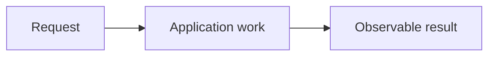

## Goal

Describe one connected implementation outcome, built from 2-4 related parts.

## Picture First

Replace this sketch with a diagram for the actual task. Add a one-line text explanation.

## Start And Dependencies

Name only the real prerequisites. Do not make a database starter wait for unrelated work.

## Context And System Design

Explain what the concept is, why it matters, and where it belongs.
Connect earlier implemented concepts and preview a useful later application.
Define unfamiliar terms without requiring future knowledge.

## Implementation Task

List 2-4 related parts. State the request without prescribing the full solution.
When replacing older issues, link each source and preserve its requirements.

## Completion Criteria

Describe observable behavior, including relevant failure behavior.
The connected path must work, not just the individual helpers. Reviewers own routine tests.

## Software And Design Principle

Name one relevant principle. Explain it in common English and point to the responsibility
decision in this project. Add a labelled picture. Do not require a pattern for its name alone.

## Database Connection

Explain a useful SQL/database connection with a picture. Before G65 this is coaching only;
it must not add database code to an existing Go task. G65 onward may explicitly scope SQL work.

## Scope

List exclusions. Tests and documentation are reviewer-owned, not learner requirements.

## Research Hints

Provide a few search phrases and reasoning prompts, not a complete walkthrough.

## Question of the Day

Previously learned concepts: name earlier implementations this question revisits.

Scenario: provide a concrete example or failure situation. Replace this placeholder.
Place a relevant diagram or execution trace before the question.

1. Ask the learner to predict and explain behavior using prior concepts.
2. Ask about the system-design consequence, responsibility, or tradeoff.

Answer every part in your own words in the relevant PR description or comment.
An issue-only answer does not satisfy this placement rule. No extra code, tests, or
documentation are required to answer. The reviewer preserves the answer, explains
corrections, and asks a targeted follow-up if needed. Learning answers are expected
but do not block merging an otherwise correct implementation.

## Interview Practice

Active level: Small. Use short sentences and explain unfamiliar words. A learner may
answer with bullets or a sketch. Judge reasoning, not English grammar.

### Small - active

Provide one small system-design scenario, its diagram, and a focused reasoning question.

Moderate - later practice, not active

Provide a larger scenario and its own picture. Explain new terms before assigning it.

Strong - future practice, not active

Provide a deeper scenario and its own picture. This is a preview, not extra implementation.

Advance only when the learner explains the simpler case and an edge case with little help
and says they are comfortable. Do not advance just because a task number is higher.
