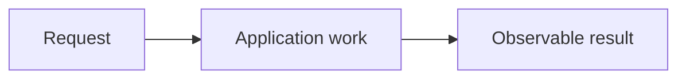

## Goal

Describe one connected implementation outcome, built from 2-4 related parts.

## Learn Before Building

Teach each unfamiliar concept before requirements, diagrams, or questions use it.
For each concept include: a plain-language definition, labelled visual, worked example or
execution trace, common failure, and what/why/where it is useful. Explain earlier and later
connections. Use examples that teach the mechanism without solving the assigned task.
Supplementary links deepen the lesson; they do not replace it. These lesson examples are
explanations, not additional assigned questions or implementation deliverables.

## Picture First

Use familiar words in this first picture. Teach unfamiliar labels before introducing them.
Replace this sketch with a diagram for the actual task. Add a one-line text explanation.

## Start And Dependencies

Name only the real prerequisites. Do not make a database starter wait for unrelated work.

## Context And System Design

Explain what the concept is, why it matters, and where it belongs.
Connect earlier implemented concepts and preview a useful later application.
Before the implementation request uses a new concept, teach its mechanism here with a
labelled visual, a worked example or execution trace, and a common failure. Define terms
beside their first use. Links and end-of-task glossaries do not replace this teaching.
Teach enough to reason independently without supplying the complete assigned solution.

## Implementation Task

List 2-4 related parts. State the request without prescribing the full solution.
When replacing older issues, link each source and preserve its requirements.

## Completion Criteria

Describe observable behavior, including relevant failure behavior.
The connected path must work, not just the individual helpers. Reviewers own routine tests.

## Software And Design Principle

Name one relevant principle. Explain it in common English and point to the responsibility
decision in this project. Add a labelled picture. Do not require a pattern for its name alone.

## Database Connection

Explain a useful SQL/database connection with a picture. Before G65 this is coaching only;
it must not add database code to an existing Go task. G65 onward may explicitly scope SQL work.

## Scope

List exclusions. Tests and documentation are reviewer-owned, not learner requirements.

Learning discussion - not extra implementation requirements

## Research Hints

Provide a few search phrases and reasoning prompts, not a complete walkthrough.

## Question of the Day

Previously learned concepts: name earlier implementations this question revisits.

Scenario: provide a concrete example or failure situation. Replace this placeholder.
Place a relevant diagram or execution trace before the question.

1. Ask the learner to predict and explain behavior using earlier completed work.
2. Ask a related consequence question. Do not repeat the current interview scenario.

Answer in your own words. Any programming language, pseudocode, or sketch is welcome.
Explain original Go/SQL behavior accurately when the question is language-specific.

## Interview Problem

Provide ONE scenario and its diagram. Begin with a small problem.
Choose a deeper follow-up in a later task based on prior answers.
Do not include a menu of difficulty levels or repeat the QOD scenario.

[Answer and coaching guidance](../../docs/learning-and-interview-guide.md).

