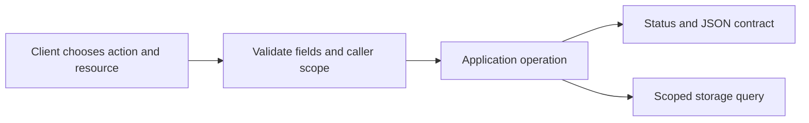
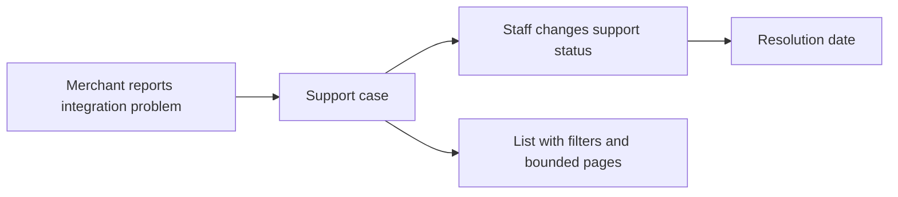

# API Contract Transfer: Mentor Roadmap

This is a later assessment plan, not extra implementation scope for the ten active issues.
Select one problem when its foundations have been taught. Do not append it as a second
interview problem to a current task.

## Concepts To Teach Before The Assessment

An API contract describes what a client may send and what the server promises in return.
A resource is a named thing exposed by the API. An endpoint combines an HTTP method
(the requested action) and a path (the resource address). A JSON schema describes fields,
types, required values, and allowed values. A status code describes the broad outcome.
Filtering selects matching records. Pagination divides a listing into bounded pages.

The contract connects the client's intention to one application outcome. A storage query
alone is not the complete public API.

**Worked example:** A read-only catalogue lookup can identify one item in its path, return
an object when found, and return a not-found outcome when absent. The contract states
the field types and failure shapes. It does not expose database column names by accident.
See [HTTP semantics](https://www.rfc-editor.org/rfc/rfc9110.html).

**Common mistake:** Listing only paths omits what callers need to send, which failures they
must handle, and whether a listing is ordered. A list limit without a defined order is not
a stable pagination contract.

**Why and where:** These skills transfer to many administrative/reporting APIs. Keep the
practice inside payment operations while asking the learner to recognize the same resource,
validation, filtering, update, and paging decisions in another domain.

## Coverage In The Current Inventory

| Contract skill | Foundation | Remaining assessment work |
| --- | --- | --- |
| Method/path, body parsing, accepted field types | SEQ-02, SEQ-04, SEQ-07 | Combine them into a complete endpoint contract. |
| Honest success and consistent failure shapes | SEQ-04, SEQ-08 | Specify examples and common failures for every endpoint. |
| Caller scope and missing records | SEQ-01, SEQ-03, SEQ-06 | Carry scope through list, lookup, and update design. |
| Filters, stable order, page size and continuation | SEQ-10 | Express query behavior as a public listing contract. |
| Safe updates, optional dates, status-dependent fields | Planned G69 | Teach update semantics before assessing a full update contract. |

The track supplies relevant foundations. Do not claim that the full create/read/update/list
API-contract exercise has already been completed or assessed.

## Later Payment-Operations Assessment

A support case is an operational report about a payment integration; changing its support
status does not change payment state or move money. Severity is the urgency rank, 1-5.
An evidence URL points to supporting material. A resolution date records when support
work finished. Teach partial-update semantics and absent-versus-NULL fields before publishing
the exercise; [PATCH semantics](https://www.rfc-editor.org/rfc/rfc5789.html) are a reference.

After the update lesson, use this single connected problem: design an API contract for
creating, reading, updating, and listing merchant-scoped support cases. Include severity,
evidence URL, open/in-progress/closed support status, and resolution date. Ask for methods,
paths, request/response field schemas, success and common failure codes, status/date rules,
filtering by status and severity, and stable bounded pagination. State access assumptions.
Accept any programming language, pseudocode, tables, or diagrams. Do not supply the finished
contract as the prompt's answer. Financial lifecycle and ledger rules remain outside it.

Begin with a smaller read/list contract if prior answers show that the whole case would
introduce too many new ideas. Extend that problem later rather than publishing several
difficulty levels together. Keep these selection rules in this mentor roadmap.
