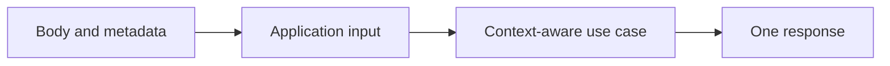
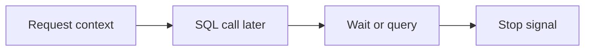
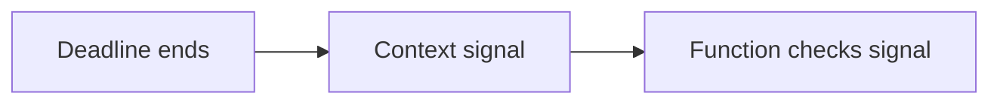
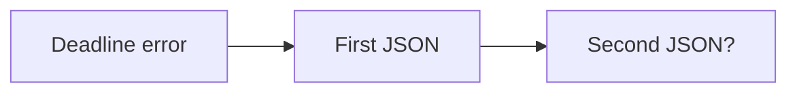
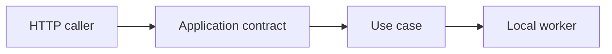
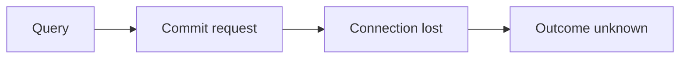

# G44/G48/G49/G50: Carry input and request lifetime through the use case

## Goal

Make application calls explicit and make each request produce one final outcome.

## Picture First

Read left to right: Body and metadata -> Application input -> Context-aware use case -> One response.

## Combined Inventory

This is one delivery assignment, not several separate PR tasks. Original goals are grouped below. A closed source issue means superseded, not achieved. Complete and review each listed goal before claiming it is done.

- [Original #55](https://github.com/Prem-Tomar/payment-api/issues/55): Day G44: Add request cancellation handling in create use case. [Saved original](../legacy/issue-55.md).
- [Original #56](https://github.com/Prem-Tomar/payment-api/issues/56): Day G48: Add request metadata input to create use case. [Saved original](../legacy/issue-56.md).
- [Original #58](https://github.com/Prem-Tomar/payment-api/issues/58): Day G49: Add timeout error mapping at application boundary. [Saved original](../legacy/issue-58.md).
- [Original #59](https://github.com/Prem-Tomar/payment-api/issues/59): Day G50: Add create payment intent command boundary. [Saved original](../legacy/issue-59.md).

## Implementation Parts

1. Observe cancellation before returning a create result (#55).
2. Pass request metadata separately from the JSON DTO (#56).
3. Map cancellation and deadline errors to distinct, single responses (#58).
4. Use one small application command/input shape (#59).

## Completion Criteria

- The use case receives the intended input, metadata, and request context.
- Direct and wrapped deadline errors produce one JSON error, with no trailing object.
- Canceled, invalid, not-implemented, and unexpected failures remain distinct.
- Show the connected success path and at least one relevant failure path in the PR discussion. A short explanation or demonstration is enough; no learner-written test suite or document is required.

## What, Why, And Where

- What: Make application calls explicit and make each request produce one final outcome.
- Why: the components must keep the same promise when they are connected.
- Where: follow the picture above through the existing project files.
- Earlier learning: Builds on shutdown cleanup, request timeout middleware, metadata, and the application interface.
- Later use: Database calls can later use the same context. A pool wait or slow query must also obey the request lifetime.

Words used here: Context: Go's request-lifetime signal. Deadline: the time when work must stop. Command input: the data for one action; it is not automatically the full Command design pattern.

## Software And Design Principle

Dependency Inversion: application work depends on a small contract, not Gin. Keep ownership of the final response clear.

Use a pattern only when it solves a visible problem. A Go function or small interface may be enough. [Short principle guide](../../software-design-principles.md).

## Database Learning Connection

Read left to right: Request context -> SQL call later -> Wait or query -> Stop signal.

This picture is a future preview. Explain the connection if useful, but do not implement SQL as an extra requirement of this assignment.
[In-depth SQL guide](../../sql-learning-guide.md).

## Question of the Day

Previously learned concepts: Builds on shutdown cleanup, request timeout middleware, metadata, and the application interface.

Read left to right: Deadline ends -> Context signal -> Function checks signal.

A context reaches its deadline. Does passing it to a function automatically stop that function? Explain passing the signal versus observing it.

Explain in your own words. Use short sentences, bullets, or a small sketch. We assess the reasoning, not English grammar.

## Interview Practice

**Active level: Small.** Start here. The mentor activates a harder level only after the learner can explain the simple case and an edge case, use a familiar example without step-by-step help, and says they are comfortable. Task number and time spent do not automatically raise the interview level.

### Small - active

Read left to right: Deadline error -> First JSON -> Second JSON?.

The handler writes a timeout error and then runs its generic error branch. Trace the two writes. Where must the response path end?

Moderate - later practice, not active yet

Read left to right: HTTP caller -> Application contract -> Use case -> Local worker.

The same use case is called by HTTP and a local worker. Choose what input both callers need and what must remain HTTP-only.

New concepts in this preview must be explained before this level is assigned.

Strong - future practice, not active yet

Read left to right: Query -> Commit request -> Connection lost -> Outcome unknown.

Later, a query succeeds but the commit response is lost. Explain why timeout, failure, and unknown outcome are different before choosing a retry policy.

The mentor introduces any new concepts first. This is a preview, not a requirement to implement another system now.

## Research Hints

Search `Go errors.Is context deadline`, `Gin response written return`, and `application service input struct`.

Look up the concept, inspect the relevant project code, then make your own implementation decision. Hints are not a complete solution.

## Scope And Coaching Agreement

This grouping keeps the original Go requirements. Database content below is coaching only; no SQL or database code is added to these legacy goals. Keep existing exclusions. Do not add real money movement, processor calls, or financial-domain logic.

Reviewers own routine tests and documentation. Implementation review checks the listed behavior. Questions and interview answers belong in the related PR description or comment, in the learner's own words. Preserve original answers and add focused corrections. Missing, partial, or incorrect learning answers are non-blocking for an otherwise correct implementation. No extra code, tests, or documentation are needed to answer.

