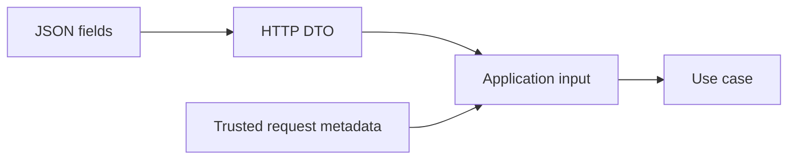
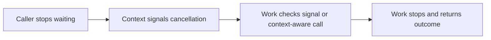
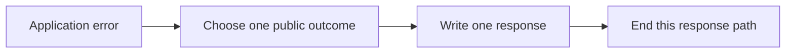
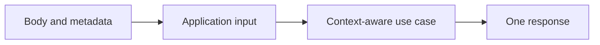
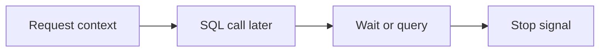
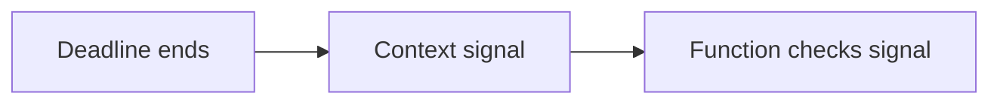
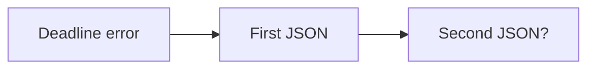

# SEQ-02 | G44/G48/G49/G50: Carry input and request lifetime through the use case

## Goal

Make application calls explicit and make each request produce one final outcome.

## Learn Before Building

### 1. Input, metadata, and the application boundary

A DTO (data transfer object) is the shape used to exchange data at a boundary, such as a JSON request. An application command is the input describing one requested operation. Metadata describes the request itself, such as merchant identity, request ID, or idempotency key. An idempotency key labels a logical request so retries can later be recognized; receiving it does not yet implement replay. A use case is the application function carrying out the requested work.

**Worked example:** Currency belongs to the requested operation. A request ID links logs to one request. A merchant value accepted from trusted middleware must not be replaced by a similarly named JSON field. Making those sources visible helps a reviewer follow who supplied each value.

**Common mistake:** Passing a Gin context or the entire transport object into application work hides which values are actually needed.

**Why and where:** Dependency Inversion means the application depends on small contracts, not Gin details. This extends existing handler/use-case separation and prepares for a SQL adapter.

### 2. Cancellation is a signal, not forced termination

A context carries a cancellation signal, deadline, and request-scoped values. Cancellation means the caller no longer wants the work; a deadline is the caller's latest acceptable finishing time. Cooperative cancellation means code or a context-aware dependency must observe the signal. A server input/output timeout limits particular network activity; it does not automatically implement cancellation inside application work.

**Worked trace:** A request begins with a short budget. Before a later storage call starts, that budget ends. Code that observes the context can avoid starting needless work. Ordinary computation that never checks the signal may continue. Context-aware SQL calls introduced later can also stop while waiting for a connection.

**Common mistake:** Replacing the request context with context.Background loses the caller's stop signal. Assuming a timeout undoes an already committed external operation gives false safety.

**Why and where:** This builds on request-context propagation. It limits wasted work and later helps bounded database calls. See [Go context](https://pkg.go.dev/context).

### 3. Error identity and one response owner

An error mapping converts an application failure into the agreed public response. A wrapped error adds context while retaining an underlying error; errors.Is can recognize that underlying identity. A response body is the bytes sent to the client. JSON is one data format for those bytes.

**Worked example:** An unrelated validation failure is mapped to one client error. The handler must then finish that path; a later success write would mix two incompatible outcomes. Treat cancellation, deadline expiry, unsupported work, and unexpected failure as distinct cases using the existing API contract.

**Common mistake:** Checking only an error's text is fragile. Writing a response does not itself prove the rest of the function will stop.

**Why and where:** Single response ownership keeps clients able to decode one result. This matters even more when a future database adapter can return several kinds of failure.

## Prerequisites

The existing service/store foundations are enough. No unfinished assignment is required.

## Picture First

Read left to right: Body and metadata -> Application input -> Context-aware use case -> One response.

## Combined Inventory

Complete the related parts below together. Source requests and saved originals are linked for reference.

- [Original #55](https://github.com/Prem-Tomar/payment-api/issues/55): Day G44: Add request cancellation handling in create use case. [Saved original](../legacy/issue-55.md).
- [Original #56](https://github.com/Prem-Tomar/payment-api/issues/56): Day G48: Add request metadata input to create use case. [Saved original](../legacy/issue-56.md).
- [Original #58](https://github.com/Prem-Tomar/payment-api/issues/58): Day G49: Add timeout error mapping at application boundary. [Saved original](../legacy/issue-58.md).
- [Original #59](https://github.com/Prem-Tomar/payment-api/issues/59): Day G50: Add create payment intent command boundary. [Saved original](../legacy/issue-59.md).

## Implementation Parts

1. Observe cancellation before returning a create result (#55).
2. Pass request metadata separately from the JSON DTO (#56).
3. Map cancellation and deadline errors to distinct, single responses (#58).
4. Use one small application command/input shape (#59).

## Completion Criteria

- The use case receives the intended input, metadata, and request context. Required metadata must be present before application work continues.
- Direct and wrapped deadline errors produce one JSON error, with no trailing object.
- Canceled, invalid, not-implemented, and unexpected failures remain distinct.
- Show the connected success path and at least one relevant failure path in the PR discussion. A short explanation or demonstration is enough; no learner-written test suite or document is required.

## Scope

This grouping keeps the original Go requirements. Database content in this assignment is coaching only; no SQL or database code is added to these legacy goals. Keep existing exclusions. Do not add real money movement, processor calls, or financial-domain logic.

Routine tests and documentation are reviewer-owned.

Learning discussion - not extra implementation requirements

## What, Why, And Where

- What: Make application calls explicit and make each request produce one final outcome.
- Why: the components must keep the same promise when they are connected.
- Where: follow the picture above through the existing project files.
- Earlier learning: Builds on shutdown cleanup, request timeout middleware, metadata, and the application interface.
- Later use: Database calls can later use the same context. A pool wait or slow query must also obey the request lifetime.

## Software And Design Principle

Dependency Inversion: application work depends on a small contract, not Gin. Keep ownership of the final response clear.

Use a pattern only when it solves a visible problem. A Go function or small interface may be enough. [Short principle guide](../../software-design-principles.md).

## Database Learning Connection

Read left to right: Request context -> SQL call later -> Wait or query -> Stop signal.

This picture is a future preview. Explain the connection if useful, but do not implement SQL as an extra requirement of this assignment.
[In-depth SQL guide](../../sql-learning-guide.md).

## Question of the Day

Previously learned concepts: Builds on shutdown cleanup, request timeout middleware, metadata, and the application interface.

Read left to right: Deadline ends -> Context signal -> Function checks signal.

A context reaches its deadline. Does passing it to a function automatically stop that function? Explain passing the signal versus observing it.

Use your own words. Any programming language, pseudocode, or a sketch is welcome. If the question concerns Go or SQL semantics, explain that original behavior correctly.

## Interview Problem

Read left to right: Deadline error -> First JSON -> Second JSON?.

The handler writes a timeout error and then runs its generic error branch. Trace the two writes. Where must the response path end?

## Research Hints

Search `Go errors.Is context deadline`, `Gin response written return`, and `application service input struct`.

Look up the concept, inspect the relevant project code, then make your own implementation decision. Hints are not a complete solution.

Reply in your own words in the PR discussion. Any programming language, pseudocode, or diagram is welcome. [Answer guidance](../../learning-and-interview-guide.md).

