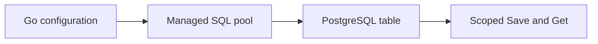
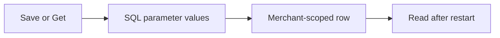
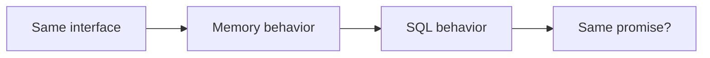
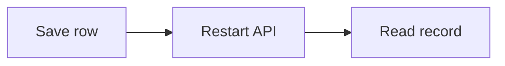

# SEQ-01 | G65: Build a working PostgreSQL store

## Goal

Deliver one usable SQL-backed store behind the existing application interface.

## Picture First

Read left to right: Go configuration -> Managed SQL pool -> PostgreSQL table -> Scoped Save and Get.

## Prerequisites

The existing service/store foundations are enough. No unfinished assignment is required.

Start now using the existing store interface and merchant-scoped lookup. This task exercises the SQL adapter directly. Align memory-store duplicate behavior in the identity assignment before switching live runtime storage in G66.

## Implementation Parts

1. Create a configurable database/sql handle using the pgx standard-library driver. Bound the connection check with a context. Keep credentials out of logs.
2. Add a versioned SQL migration for learning record metadata. Store merchant identity, record ID, and creation time. Use deliberate types, required values, and scoped identity.
3. Implement Save with bound SQL parameters and a clear duplicate outcome. Do not build query text from caller values.
4. Implement merchant-scoped Get with a context, explicit columns, and correct no-row handling.

## Completion Criteria

- The same application store contract can use the SQL adapter.
- A saved row can be read by its merchant and ID after reconnecting.
- Another merchant cannot read that row; duplicate identity does not silently overwrite it.
- The database handle has a clear close owner. No HTTP route is switched to SQL in this task.
- Show the connected success path and at least one relevant failure path in the PR discussion. A short explanation or demonstration is enough; no learner-written test suite or document is required.

## Scope

Use local learning data only. PostgreSQL stores operational/request metadata. Keep financial calculations, ledger rules, processor calls, and real payment lifecycle decisions outside this assignment.

Routine tests and documentation are reviewer-owned.

Learning discussion - not extra implementation requirements

## What, Why, And Where

- What: Deliver one usable SQL-backed store behind the existing application interface.
- Why: the components must keep the same promise when they are connected.
- Where: follow the picture above through the existing project files.
- Earlier learning: Builds on the store interface, scoped map keys, config loading, and context propagation.
- Later use: G66 wires the store into runtime behavior. Later tasks add transactions and query analysis.

Words used here: SQL: a language for reading and changing tables. Migration: a saved schema change. Pool: reusable database connections. Parameter: a value passed separately from SQL text.

## Software And Design Principle

Dependency Inversion keeps SQL behind the store interface. Compare behavior as well as Go method signatures. Full runtime substitution also needs the identity assignment's duplicate-record contract. GRASP Creator asks who has the information to construct and own the store.

Use a pattern only when it solves a visible problem. A Go function or small interface may be enough. [Short principle guide](../../software-design-principles.md).

## Database Learning Connection

Read left to right: Save or Get -> SQL parameter values -> Merchant-scoped row -> Read after restart.

This assignment includes database implementation. See the SQL practice guide for clause order, row prediction, failure behavior, and query-plan coaching.
[In-depth SQL guide](../../sql-learning-guide.md).

## Question of the Day

Previously learned concepts: Builds on the store interface, scoped map keys, config loading, and context propagation.

Read left to right: Same interface -> Memory behavior -> SQL behavior -> Same promise?.

The memory store and SQL store both implement one Go interface. Is successful compilation enough to prove they are interchangeable? Use missing records and duplicate records as examples.

Use your own words. Any programming language, pseudocode, or a sketch is welcome. If the question concerns Go or SQL semantics, explain that original behavior correctly.

## Interview Problem

Read left to right: Save row -> Restart API -> Read record.

Your API process restarts. Compare a map record and a SQL row. Which behavior must a client be told to expect?

## Research Hints

Search `database/sql managing connections`, `pgx stdlib`, `PostgreSQL composite primary key`, and `QueryRowContext sql.ErrNoRows`.

Look up the concept, inspect the relevant project code, then make your own implementation decision. Hints are not a complete solution.

For discussion, any programming language, pseudocode, or diagram is accepted. QOD revisits earlier work; the interview examples explore different scenarios. [How learning answers are reviewed](../../learning-and-interview-guide.md).

