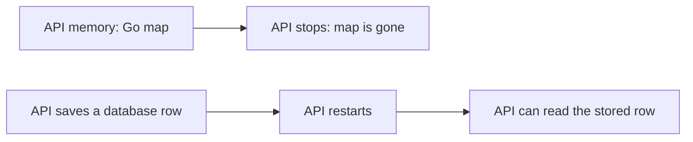
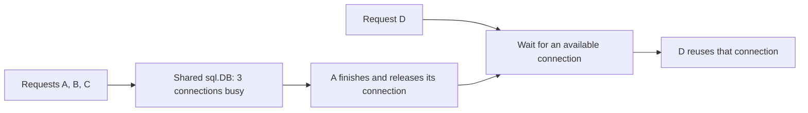
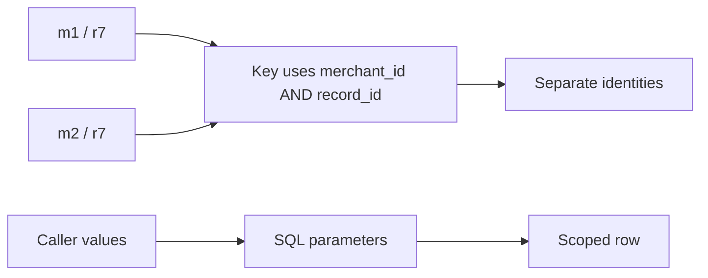
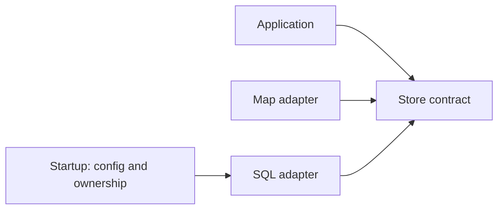
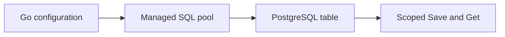
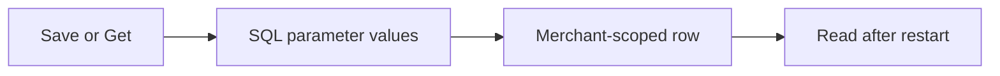
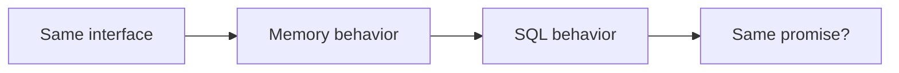
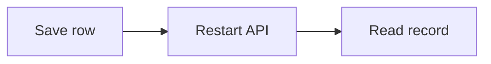

# SEQ-01 | G65: Build a working PostgreSQL store

## Goal

Deliver one usable SQL-backed store behind the existing application interface.

## Learn Before Building

### 1. From a Go map to stored rows

A database is a separate program that stores and retrieves data. PostgreSQL is the database used here. SQL is the language used to ask it to read or change data. A table holds records of one kind. A row is one record; columns are its named fields. Persistence means accepted data can survive an API restart. It still needs reliable database storage and recovery; restarting the API is not the same as deleting the database.

**Worked example:** A learning record has merchant_id = m1, record_id = r7, and created_at = a timestamp. Think of one table row with those three columns. Closing the API process removes its map, but does not by itself remove that PostgreSQL row. The store interface is the application's small promise for Save and Get. An adapter is code that fits PostgreSQL to that promise.

**Common mistake:** Treating a successful connection as proof that a row was saved, or treating an API restart as a database reset.

**Why and where:** This extends the existing map store. Separate storage supports later API restarts and multiple API instances; the HTTP layer does not need to know SQL.

### 2. Connections and the connection pool

A connection is a communication session between the API and PostgreSQL. It carries commands; it is not a stored record. A connection pool is a managed set of connections that work can borrow and reuse. Go's sql.DB is a shared handle that manages this set. A handle is an object through which code uses another resource. The pgx driver translates database/sql operations into PostgreSQL communication; its stdlib adapter lets it work with database/sql.

**Worked trace:** With an illustrative maximum of 3 open connections, A, B, and C each borrow one. D waits. Once A releases its connection, D can borrow it. A context carries a stop signal and deadline; passing it to a context-aware database call lets that call stop waiting when its budget ends. A deadline is the latest time the caller is willing to wait. Three is an example, not a required setting.

A connection doing work is in use. An idle connection is open but available for reuse. MaxOpenConns bounds the total open connections, including in-use and idle connections. MaxIdleConns bounds how many unused ones are retained. These settings control different quantities. Opening a handle need not establish a working database session; PingContext checks connectivity within a context. Database credentials are the login secrets used to connect.

**Common mistake:** Creating and closing sql.DB inside every request defeats sharing. A borrowed connection can stay occupied if query results are left open. With multi-row results, finish or close Rows and check its error; with QueryRowContext, consume the outcome through Scan.

**Why and where:** Connection reuse avoids repeated setup. A finite pool limits simultaneous database sessions, not requests per minute. Unlike a public rate limiter, it manages a shared resource. Two API processes each allowing 3 connections may use 6 in total. The startup/shutdown owner shares and closes the handle after request work ends. See [connection management](https://go.dev/doc/database/manage-connections), [opening handles](https://go.dev/doc/database/open-handle), and [database/sql](https://pkg.go.dev/database/sql).

### 3. Schema, identity, and safe queries

A schema describes tables, columns, and rules. A migration is a saved, ordered schema change. A constraint is a rule PostgreSQL enforces. NOT NULL requires a value; a primary key identifies each row and prevents duplicate identities. A composite key uses several columns together. Merchant scope means a record is identified within the requesting merchant's boundary.

**Worked example:** (m1, r7) and (m2, r7) can identify different rows. A second (m1, r7) is a duplicate identity; saving it must not silently replace the first record. Text, integer, and timestamp column types express different data. Choose compatible ranges when moving between Go and SQL.

A parameter is a value supplied separately from SQL command text. In an unrelated catalogue example, item_name = $1 keeps the command structure fixed while a supplied name becomes data. Explicit columns make the expected result clear. A predicate is a condition such as merchant_id = $1 used to select rows. QueryRowContext reads at most one row; Scan copies its column values into Go destinations and reports sql.ErrNoRows if none matched.

**Common mistake:** Combining caller strings into SQL text changes values into possible command syntax. Looking up by record ID alone drops merchant isolation. Confusing no row with a broken connection hides the real outcome.

**Why and where:** Schema rules protect stored identity even with multiple callers. Safe query parameters and scoped conditions build on validated Go input. The later runtime task connects this adapter to HTTP. See [constraints](https://www.postgresql.org/docs/current/ddl-constraints.html) and [querying](https://go.dev/doc/database/querying).

### 4. Design responsibilities

Dependency Inversion means application behavior depends on a small contract instead of a storage tool. Liskov Substitution means a replacement must preserve the behavior promised by that contract. GRASP is a set of responsibility guidelines; its Creator guideline asks which component has the information needed to create and connect an object.

**Worked example:** Startup has database settings, so it can construct the shared handle and give the SQL adapter to the application. The HTTP handler can continue calling the application. A matching method signature helps the compiler; explicit missing-record and duplicate outcomes make the caller's behavior predictable.

**Common mistake:** Letting handlers open databases or decide shutdown ownership mixes unrelated responsibilities.

**Why and where:** These principles explain where this task's code belongs. They do not require a factory framework or a complete payment state machine.

## Picture First

Read left to right: Go configuration -> Managed SQL pool -> PostgreSQL table -> Scoped Save and Get.

## Prerequisites

The existing service/store foundations are enough. No unfinished assignment is required.

Start now using the existing store interface and merchant-scoped lookup. This task exercises the SQL adapter directly. Align memory-store duplicate behavior in the identity assignment before switching live runtime storage in G66.

## Implementation Parts

1. Create a configurable database/sql handle using the pgx standard-library driver. Bound the connection check with a context. Keep credentials out of logs.
2. Add a versioned SQL migration for learning record metadata. Store merchant identity, record ID, and creation time. Use deliberate types, required values, and scoped identity.
3. Implement Save with bound SQL parameters and a clear duplicate outcome. Do not build query text from caller values.
4. Implement merchant-scoped Get with a context, explicit columns, and correct no-row handling.

## Completion Criteria

- The same application store contract can use the SQL adapter.
- A saved row can be read by its merchant and ID after reconnecting.
- Another merchant cannot read that row; duplicate identity does not silently overwrite it.
- The database handle has a clear close owner. No HTTP route is switched to SQL in this task.
- Show the connected success path and at least one relevant failure path in the PR discussion. A short explanation or demonstration is enough; no learner-written test suite or document is required.

## Scope

Use local learning data only. PostgreSQL stores operational/request metadata. Keep financial calculations, ledger rules, processor calls, and real payment lifecycle decisions outside this assignment.

Routine tests and documentation are reviewer-owned.

Learning discussion - not extra implementation requirements

## What, Why, And Where

- What: Deliver one usable SQL-backed store behind the existing application interface.
- Why: the components must keep the same promise when they are connected.
- Where: follow the picture above through the existing project files.
- Earlier learning: Builds on the store interface, scoped map keys, config loading, and context propagation.
- Later use: G66 wires the store into runtime behavior. Later tasks add transactions and query analysis.

## Software And Design Principle

Dependency Inversion keeps SQL behind the store interface. Compare behavior as well as Go method signatures. Full runtime substitution also needs the identity assignment's duplicate-record contract. GRASP Creator asks who has the information to construct and own the store.

Use a pattern only when it solves a visible problem. A Go function or small interface may be enough. [Short principle guide](../../software-design-principles.md).

## Database Learning Connection

Read left to right: Save or Get -> SQL parameter values -> Merchant-scoped row -> Read after restart.

This assignment includes database implementation. See the SQL practice guide for clause order, row prediction, failure behavior, and query-plan coaching.
[In-depth SQL guide](../../sql-learning-guide.md).

## Question of the Day

Previously learned concepts: Builds on the store interface, scoped map keys, config loading, and context propagation.

Read left to right: Same interface -> Memory behavior -> SQL behavior -> Same promise?.

The memory store and SQL store both implement one Go interface. Is successful compilation enough to prove they are interchangeable? Use missing records and duplicate records as examples.

Use your own words. Any programming language, pseudocode, or a sketch is welcome. If the question concerns Go or SQL semantics, explain that original behavior correctly.

## Interview Problem

Read left to right: Save row -> Restart API -> Read record.

Your API process restarts. Compare a map record and a SQL row. Which behavior must a client be told to expect?

## Research Hints

Search `database/sql managing connections`, `pgx stdlib`, `PostgreSQL composite primary key`, and `QueryRowContext sql.ErrNoRows`.

Look up the concept, inspect the relevant project code, then make your own implementation decision. Hints are not a complete solution.

Reply in your own words in the PR discussion. Any programming language, pseudocode, or diagram is welcome. [Answer guidance](../../learning-and-interview-guide.md).

