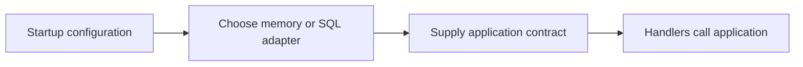
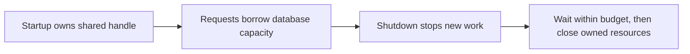
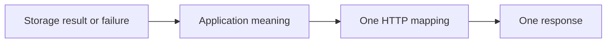
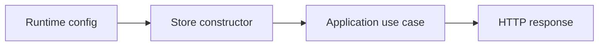
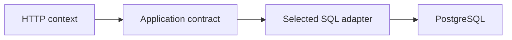
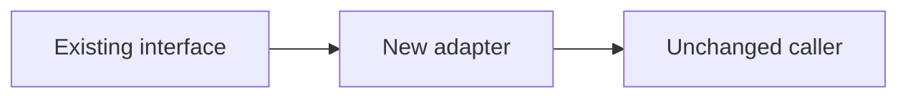
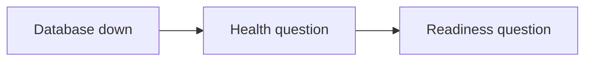

# SEQ-06 | G66: Integrate the SQL store with service lifecycle and errors

## Goal

Make SQL an explicit runtime option without mixing SQL details into handlers.

## Learn Before Building

### 1. Construction and runtime selection

An adapter fits a tool, such as SQL storage, to an application contract. The composition root is the startup location that constructs and connects dependencies. Dependency injection means supplying those dependencies from outside a component. Runtime configuration selects how the running application is built.

**Worked example:** Startup reads storage mode once, constructs the selected store, and gives it to the application. A lookup handler then performs the same application call in either mode. A factory is a construction function or technique; GRASP Creator is the responsibility guideline for deciding who has the information to create the dependency.

**Common mistake:** Selecting and opening a database separately inside each handler duplicates ownership and can create many pools.

**Why and where:** Single Responsibility keeps construction separate from request handling. This extends G65's adapter into one complete runtime path without adding financial behavior.

### 2. Shared resources need a shutdown owner

G65 introduced sql.DB, the shared connection-pool handle. Lifecycle means when a resource starts, is used, and ends. Graceful shutdown stops accepting new work and gives existing work a bounded chance to finish. A context carries a deadline and cancellation signal.

**Worked trace:** Several requests use one handle. Ending one request releases its own query resources; it must not close the shared handle used by others. When the process shuts down, the lifecycle owner coordinates server work and database closure. A SQL readiness check uses PingContext with a short budget; health remains an independent process check.

**Common mistake:** Closing sql.DB after a single lookup or starting an unlimited readiness wait can make an otherwise healthy service unavailable.

**Why and where:** This connects readiness injection, request budgets, and graceful shutdown to real storage. Pool capacity and public rate limits remain distinct.

### 3. Translate storage outcomes without inventing success

A storage contract includes behavior as well as method signatures. No row, duplicate identity, cancellation, deadline expiry, and unavailable storage are different outcomes. An error chain preserves an underlying cause through added context; errors.Is checks causes without matching prose.

**Worked example:** An unavailable catalogue database must not be described as an empty catalogue. Similarly, selecting SQL for lookup does not make an unsupported create operation complete. A placeholder remains a placeholder until its actual write path exists.

**Common mistake:** Exposing driver text or credentials to the client, or writing a second generic JSON response after a specific error response.

**Why and where:** This preserves earlier input, identity, and truthful-output work. [Go database/sql documentation](https://pkg.go.dev/database/sql) gives the exact handle methods; the assignment remains about integrating their behavior.

## Picture First

Read left to right: Runtime config -> Store constructor -> Application use case -> HTTP response.

## Prerequisites

- SEQ-01: [issue #78](https://github.com/Prem-Tomar/payment-api/issues/78).
- SEQ-02: [issue #59](https://github.com/Prem-Tomar/payment-api/issues/59).
- SEQ-03: [issue #65](https://github.com/Prem-Tomar/payment-api/issues/65).
- SEQ-04: [issue #60](https://github.com/Prem-Tomar/payment-api/issues/60).
- SEQ-05: [issue #51](https://github.com/Prem-Tomar/payment-api/issues/51).

Start after G65. Fix the request-lifetime assignment's malformed deadline response before enabling real query calls in HTTP.

## Implementation Parts

1. Select memory or SQL storage at a clear construction point. Keep handlers dependent on application contracts.
2. Wire scoped lookup to the selected store. Keep placeholder creation honest until it has a supported write path.
3. Use a short context-aware database check for readiness in SQL mode. Keep the cheap health endpoint independent.
4. Map no-row, duplicate, cancellation, and unavailable-database outcomes without exposing SQL text or credentials. Close the shared handle during shutdown.

## Completion Criteria

- Changing storage mode does not require handler SQL.
- Operational routes and request cancellation remain predictable.
- Each failure produces one coherent HTTP response.
- SQL mode stops accepting work cleanly during shutdown.
- Show the connected success path and at least one relevant failure path in the PR discussion. A short explanation or demonstration is enough; no learner-written test suite or document is required.

## Scope

Use local learning data only. PostgreSQL stores operational/request metadata. Keep financial calculations, ledger rules, processor calls, and real payment lifecycle decisions outside this assignment.

Routine tests and documentation are reviewer-owned.

Learning discussion - not extra implementation requirements

## What, Why, And Where

- What: Make SQL an explicit runtime option without mixing SQL details into handlers.
- Why: the components must keep the same promise when they are connected.
- Where: follow the picture above through the existing project files.
- Earlier learning: Builds on G65, config, readiness injection, typed errors, and graceful shutdown.
- Later use: The same construction point can later add measured pool settings without changing route code.

## Software And Design Principle

Creator responsibility chooses who builds dependencies; a creational factory is only one possible mechanism. Single Responsibility keeps construction out of handlers.

Use a pattern only when it solves a visible problem. A Go function or small interface may be enough. [Short principle guide](../../software-design-principles.md).

## Database Learning Connection

Read left to right: HTTP context -> Application contract -> Selected SQL adapter -> PostgreSQL.

This assignment includes database implementation. See the SQL practice guide for clause order, row prediction, failure behavior, and query-plan coaching.
[In-depth SQL guide](../../sql-learning-guide.md).

## Question of the Day

Previously learned concepts: Builds on G65, config, readiness injection, typed errors, and graceful shutdown.

Read left to right: Existing interface -> New adapter -> Unchanged caller.

The current readiness checker is injectable and the query service already accepts an interface. How do these earlier choices help replace a map without changing the HTTP contract?

Use your own words. Any programming language, pseudocode, or a sketch is welcome. If the question concerns Go or SQL semantics, explain that original behavior correctly.

## Interview Problem

Read left to right: Database down -> Health question -> Readiness question.

The database is down. Decide what health and readiness should each report, and why they answer different questions.

## Research Hints

Search `Go sql.DB lifecycle`, `PingContext readiness`, `dependency injection composition root`, and `errors.Is database error mapping`.

Look up the concept, inspect the relevant project code, then make your own implementation decision. Hints are not a complete solution.

Reply in your own words in the PR discussion. Any programming language, pseudocode, or diagram is welcome. [Answer guidance](../../learning-and-interview-guide.md).

