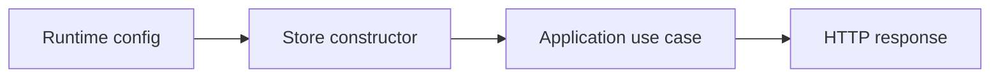
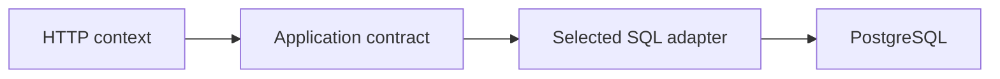
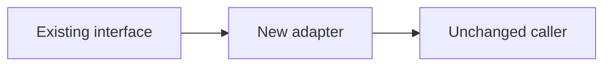
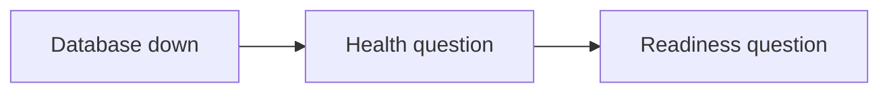
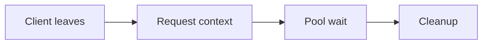
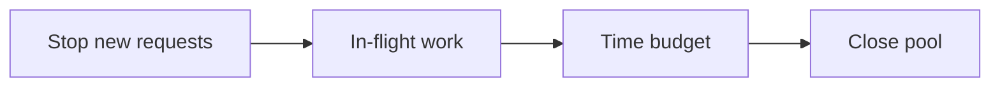

# G66: Integrate the SQL store with service lifecycle and errors

## Goal

Make SQL an explicit runtime option without mixing SQL details into handlers.

## Picture First

Read left to right: Runtime config -> Store constructor -> Application use case -> HTTP response.

## Start And Dependencies

Start after G65. Fix the request-lifetime assignment's malformed deadline response before enabling real query calls in HTTP.

## Implementation Parts

1. Select memory or SQL storage at a clear construction point. Keep handlers dependent on application contracts.
2. Wire scoped lookup to the selected store. Keep placeholder creation honest until it has a supported write path.
3. Use a short context-aware database check for readiness in SQL mode. Keep the cheap health endpoint independent.
4. Map no-row, duplicate, cancellation, and unavailable-database outcomes without exposing SQL text or credentials. Close the shared handle during shutdown.

## Completion Criteria

- Changing storage mode does not require handler SQL.
- Operational routes and request cancellation remain predictable.
- Each failure produces one coherent HTTP response.
- SQL mode stops accepting work cleanly during shutdown.
- Show the connected success path and at least one relevant failure path in the PR discussion. A short explanation or demonstration is enough; no learner-written test suite or document is required.

## What, Why, And Where

- What: Make SQL an explicit runtime option without mixing SQL details into handlers.
- Why: the components must keep the same promise when they are connected.
- Where: follow the picture above through the existing project files.
- Earlier learning: Builds on G65, config, readiness injection, typed errors, and graceful shutdown.
- Later use: The same construction point can later add measured pool settings without changing route code.

Words used here: Composition root: the place that creates and connects dependencies. Adapter: code that fits one storage tool to an application interface.

## Software And Design Principle

Creator responsibility chooses who builds dependencies; a creational factory is only one possible mechanism. Single Responsibility keeps construction out of handlers.

Use a pattern only when it solves a visible problem. A Go function or small interface may be enough. [Short principle guide](../../software-design-principles.md).

## Database Learning Connection

Read left to right: HTTP context -> Application contract -> Selected SQL adapter -> PostgreSQL.

This assignment includes database implementation. See the SQL practice guide for clause order, row prediction, failure behavior, and query-plan coaching.
[In-depth SQL guide](../../sql-learning-guide.md).

## Question of the Day

Previously learned concepts: Builds on G65, config, readiness injection, typed errors, and graceful shutdown.

Read left to right: Existing interface -> New adapter -> Unchanged caller.

The current readiness checker is injectable and the query service already accepts an interface. How do these earlier choices help replace a map without changing the HTTP contract?

Explain in your own words. Use short sentences, bullets, or a small sketch. We assess the reasoning, not English grammar.

## Interview Practice

**Active level: Small.** Start here. The mentor activates a harder level only after the learner can explain the simple case and an edge case, use a familiar example without step-by-step help, and says they are comfortable. Task number and time spent do not automatically raise the interview level.

### Small - active

Read left to right: Database down -> Health question -> Readiness question.

The database is down. Decide what health and readiness should each report, and why they answer different questions.

Moderate - later practice, not active yet

Read left to right: Client leaves -> Request context -> Pool wait -> Cleanup.

A client disconnects while waiting for a connection. Trace the context through handler, use case, and SQL adapter. Which component owns cleanup?

New concepts in this preview must be explained before this level is assigned.

Strong - future practice, not active yet

Read left to right: Stop new requests -> In-flight work -> Time budget -> Close pool.

Later, shutdown begins while requests are using the shared pool. Order stopping new work, waiting, canceling, and closing resources. State the limits of your promise.

The mentor introduces any new concepts first. This is a preview, not a requirement to implement another system now.

## Research Hints

Search `Go sql.DB lifecycle`, `PingContext readiness`, `dependency injection composition root`, and `errors.Is database error mapping`.

Look up the concept, inspect the relevant project code, then make your own implementation decision. Hints are not a complete solution.

## Scope And Coaching Agreement

Use local learning data only. PostgreSQL stores operational/request metadata. Keep financial calculations, ledger rules, processor calls, and real payment lifecycle decisions outside this assignment.

Reviewers own routine tests and documentation. Implementation review checks the listed behavior. Questions and interview answers belong in the related PR description or comment, in the learner's own words. Preserve original answers and add focused corrections. Missing, partial, or incorrect learning answers are non-blocking for an otherwise correct implementation. No extra code, tests, or documentation are needed to answer.

