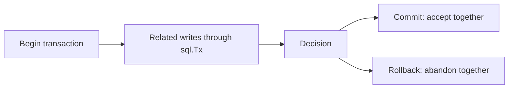
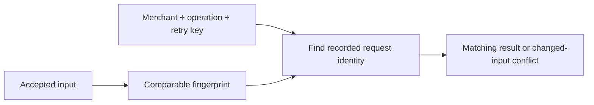
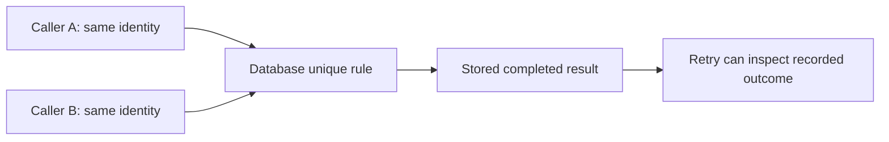
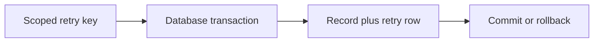
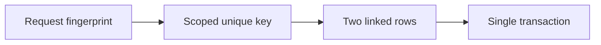
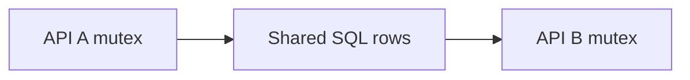
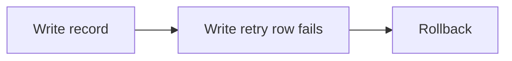

# SEQ-09 | G67: Add atomic learning records and safe retry identity in SQL

## Goal

Keep a learning record and its retry identity consistent during success, failure, and a retry.

## Learn Before Building

### 1. Related writes need one transaction

A transaction is a group of database operations that finish as one accepted change or are abandoned together. Atomicity is that all-or-nothing property. Commit asks the database to accept the transaction; rollback abandons its uncommitted changes. Go's sql.Tx is the handle for operations inside one transaction.

**Worked example:** A catalogue import adds an item row and its import-history row. If history insertion fails before commit, the item must not remain as an accepted half-import. Every operation intended to be in the transaction uses its transaction handle. Calling sql.DB separately can use another connection outside that transaction.

**Common mistake:** Assuming two individual SQL successes form one atomic workflow. A transaction also does not automatically prevent every possible interaction with other concurrent transactions.

**Why and where:** This extends earlier duplicate protection into shared storage. Transaction coordination belongs at the application/storage boundary, not inside JSON parsing. See [Go transactions](https://go.dev/doc/database/execute-transactions).

### 2. Retry identity and request meaning

Idempotency means a repeated logical request does not accidentally create another effect. A retry identity combines merchant, operation, and retry key. A request fingerprint represents the meaningful accepted input so a repeated key can be checked against its original request. A hash is a compact digest of data; it is not encryption, and it does not decide which fields are meaningful.

**Worked example:** A catalogue import retry with the same identity and the same accepted content refers to the original import. Changing the content while reusing that identity is a different request, not permission to return the old result. Representing input consistently matters: harmless JSON field order should not become an accidental new business meaning.

**Common mistake:** Using the key globally mixes merchants. Hashing raw request bytes without considering accepted meaning can make equivalent input look different. A stored digest must not be presented as protected secret data.

**Why and where:** This builds on the earlier merchant-scoped retry record shape. Information Expert puts the decision near the stored identity and result. Keep the concrete transaction small instead of building a general Unit of Work framework, which would be an abstraction for coordinating many kinds of changes.

### 3. Competing callers and uncertain outcomes

A unique constraint is a database-enforced rule allowing only one stored row for a chosen identity. A uniqueness race occurs when callers attempt that identity concurrently. SQLSTATE is a structured database error category; inspect documented driver/database identity rather than error-message text. An uncertain outcome means the caller cannot confirm whether the database accepted work.

**Worked trace:** An import commits, but the connection fails before the caller receives confirmation. The missing reply does not prove rollback. A later attempt needs the recorded identity and outcome, rather than a blind new write. A duplicate insertion error also does not alone prove the request content matched or that a completed result exists. After a PostgreSQL statement error, transaction state must be handled deliberately before reading again.

**Common mistake:** Converting every unique violation into success, or blindly retrying every failed commit as a fresh operation.

**Why and where:** This prepares for later isolation and bounded-retry lessons. Dependency Inversion keeps driver-specific classification behind storage contracts. Only synthetic learning records are involved; no real charge or ledger operation is added.

## Picture First

Read left to right: Scoped retry key -> Database transaction -> Record plus retry row -> Commit or rollback.

## Prerequisites

- SEQ-06: [issue #79](https://github.com/Prem-Tomar/payment-api/issues/79).
- SEQ-07: [issue #64](https://github.com/Prem-Tomar/payment-api/issues/64).
- SEQ-08: [issue #70](https://github.com/Prem-Tomar/payment-api/issues/70).

Start after G65 and the identity-safety assignment. Use request metadata already carried into the application. G66 is needed before HTTP wiring.

## Implementation Parts

1. Add a migration for merchant-scoped idempotency records. Use required identity fields and a unique rule that includes merchant, operation, and retry key.
2. Add SQL operations for the idempotency boundary using bound parameters. Model missing and completed results explicitly.
3. Create the learning record and its retry record in one sql.Tx. Use the transaction handle for all work in that transaction.
4. Return the previous result for a matching completed retry; reject changed input for the same retry identity. Handle uniqueness races as outcomes, not as generic success.

## Completion Criteria

- Failure before commit does not leave half of the linked work stored.
- Matching retries do not create another learning record.
- Different merchants can choose the same retry key independently.
- A conflicting payload is not replayed as if it matched. No real charge or ledger write is performed.
- Show the connected success path and at least one relevant failure path in the PR discussion. A short explanation or demonstration is enough; no learner-written test suite or document is required.

## Scope

Use local learning data only. PostgreSQL stores operational/request metadata. Keep financial calculations, ledger rules, processor calls, and real payment lifecycle decisions outside this assignment.

Routine tests and documentation are reviewer-owned.

Learning discussion - not extra implementation requirements

## What, Why, And Where

- What: Keep a learning record and its retry identity consistent during success, failure, and a retry.
- Why: the components must keep the same promise when they are connected.
- Where: follow the picture above through the existing project files.
- Earlier learning: Builds on scoped IDs, duplicate protection, idempotency records, and request context.
- Later use: Later concurrency lessons examine isolation, failed commit responses, and bounded retries.

## Software And Design Principle

Information Expert and Dependency Inversion: keep transaction coordination in application/storage boundaries, not HTTP parsing. Do not add a general Unit of Work framework just to use one transaction.

Use a pattern only when it solves a visible problem. A Go function or small interface may be enough. [Short principle guide](../../software-design-principles.md).

## Database Learning Connection

Read left to right: Request fingerprint -> Scoped unique key -> Two linked rows -> Single transaction.

This assignment includes database implementation. See the SQL practice guide for clause order, row prediction, failure behavior, and query-plan coaching.
[In-depth SQL guide](../../sql-learning-guide.md).

## Question of the Day

Previously learned concepts: Builds on scoped IDs, duplicate protection, idempotency records, and request context.

Read left to right: API A mutex -> Shared SQL rows -> API B mutex.

Earlier, a Go mutex protected a map. If two API processes now share PostgreSQL, can one process's mutex protect both? Explain which earlier identity rule still matters.

Use your own words. Any programming language, pseudocode, or a sketch is welcome. If the question concerns Go or SQL semantics, explain that original behavior correctly.

## Interview Problem

Read left to right: Write record -> Write retry row fails -> Rollback.

The first SQL write succeeds and the second fails. What should remain after rollback? Explain why two separate successful statements are not one atomic workflow.

## Research Hints

Search `Go sql.Tx Commit Rollback`, `PostgreSQL unique constraint concurrent insert`, `SQL idempotency request fingerprint`, and `SQLSTATE unique violation`.

Look up the concept, inspect the relevant project code, then make your own implementation decision. Hints are not a complete solution.

Reply in your own words in the PR discussion. Any programming language, pseudocode, or diagram is welcome. [Answer guidance](../../learning-and-interview-guide.md).

