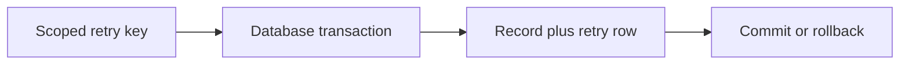
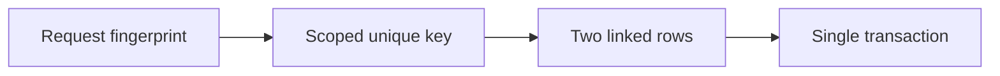
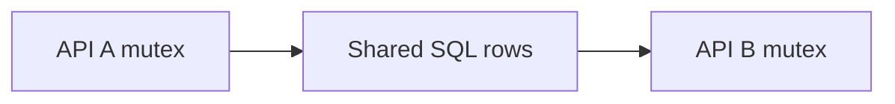
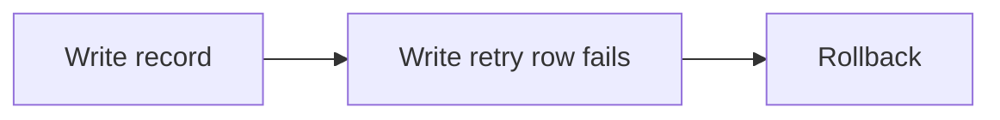
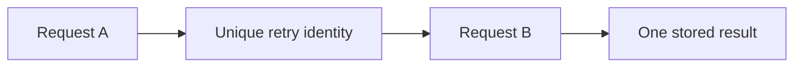
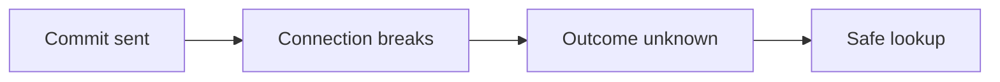

# G67: Add atomic learning records and safe retry identity in SQL

## Goal

Keep a learning record and its retry identity consistent during success, failure, and a retry.

## Picture First

Read left to right: Scoped retry key -> Database transaction -> Record plus retry row -> Commit or rollback.

## Start And Dependencies

Start after G65 and the identity-safety assignment. Use request metadata already carried into the application. G66 is needed before HTTP wiring.

## Implementation Parts

1. Add a migration for merchant-scoped idempotency records. Use required identity fields and a unique rule that includes merchant, operation, and retry key.
2. Add SQL operations for the idempotency boundary using bound parameters. Model missing and completed results explicitly.
3. Create the learning record and its retry record in one sql.Tx. Use the transaction handle for all work in that transaction.
4. Return the previous result for a matching completed retry; reject changed input for the same retry identity. Handle uniqueness races as outcomes, not as generic success.

## Completion Criteria

- Failure before commit does not leave half of the linked work stored.
- Matching retries do not create another learning record.
- Different merchants can choose the same retry key independently.
- A conflicting payload is not replayed as if it matched. No real charge or ledger write is performed.
- Show the connected success path and at least one relevant failure path in the PR discussion. A short explanation or demonstration is enough; no learner-written test suite or document is required.

## What, Why, And Where

- What: Keep a learning record and its retry identity consistent during success, failure, and a retry.
- Why: the components must keep the same promise when they are connected.
- Where: follow the picture above through the existing project files.
- Earlier learning: Builds on scoped IDs, duplicate protection, idempotency records, and request context.
- Later use: Later concurrency lessons examine isolation, failed commit responses, and bounded retries.

Words used here: Transaction: a group of database changes committed together. Commit: make those changes part of the database. Rollback: abandon the transaction's changes. Idempotency: retries must not create accidental duplicate work.

## Software And Design Principle

Information Expert and Dependency Inversion: keep transaction coordination in application/storage boundaries, not HTTP parsing. Do not add a general Unit of Work framework just to use one transaction.

Use a pattern only when it solves a visible problem. A Go function or small interface may be enough. [Short principle guide](../../software-design-principles.md).

## Database Learning Connection

Read left to right: Request fingerprint -> Scoped unique key -> Two linked rows -> Single transaction.

This assignment includes database implementation. See the SQL practice guide for clause order, row prediction, failure behavior, and query-plan coaching.
[In-depth SQL guide](../../sql-learning-guide.md).

## Question of the Day

Previously learned concepts: Builds on scoped IDs, duplicate protection, idempotency records, and request context.

Read left to right: API A mutex -> Shared SQL rows -> API B mutex.

Earlier, a Go mutex protected a map. If two API processes now share PostgreSQL, can one process's mutex protect both? Explain which earlier identity rule still matters.

Explain in your own words. Use short sentences, bullets, or a small sketch. We assess the reasoning, not English grammar.

## Interview Practice

**Active level: Small.** Start here. The mentor activates a harder level only after the learner can explain the simple case and an edge case, use a familiar example without step-by-step help, and says they are comfortable. Task number and time spent do not automatically raise the interview level.

### Small - active

Read left to right: Write record -> Write retry row fails -> Rollback.

The first SQL write succeeds and the second fails. What should remain after rollback? Explain why two separate successful statements are not one atomic workflow.

Moderate - later practice, not active yet

Read left to right: Request A -> Unique retry identity -> Request B -> One stored result.

Two requests with the same merchant and retry key arrive together. Explain which database rule must decide the winner and what the loser should read.

New concepts in this preview must be explained before this level is assigned.

Strong - future practice, not active yet

Read left to right: Commit sent -> Connection breaks -> Outcome unknown -> Safe lookup.

Later, a connection breaks while commit is being acknowledged. Explain the difference between a confirmed rollback and an unknown outcome. How could scoped retry identity help recovery?

The mentor introduces any new concepts first. This is a preview, not a requirement to implement another system now.

## Research Hints

Search `Go sql.Tx Commit Rollback`, `PostgreSQL unique constraint concurrent insert`, `SQL idempotency request fingerprint`, and `SQLSTATE unique violation`.

Look up the concept, inspect the relevant project code, then make your own implementation decision. Hints are not a complete solution.

## Scope And Coaching Agreement

Use local learning data only. PostgreSQL stores operational/request metadata. Keep financial calculations, ledger rules, processor calls, and real payment lifecycle decisions outside this assignment.

Reviewers own routine tests and documentation. Implementation review checks the listed behavior. Questions and interview answers belong in the related PR description or comment, in the learner's own words. Preserve original answers and add focused corrections. Missing, partial, or incorrect learning answers are non-blocking for an otherwise correct implementation. No extra code, tests, or documentation are needed to answer.

