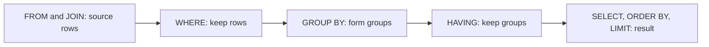
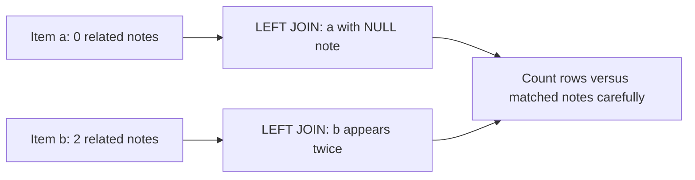
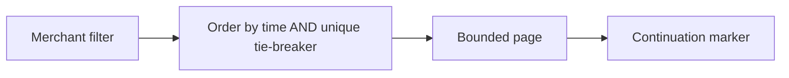
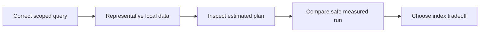
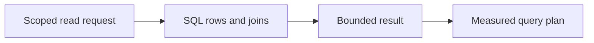
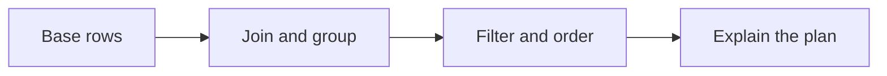
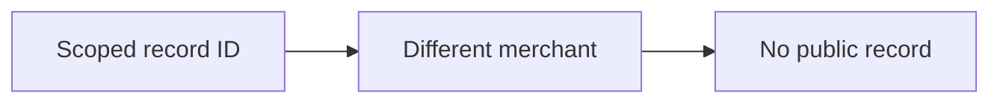
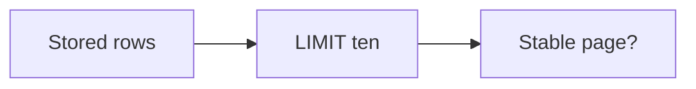

# SEQ-10 | G68: Build and explain useful SQL queries

## Goal

Deliver a small read boundary that explains stored learning operations accurately and efficiently.

## Learn Before Building

### 1. Read SQL as a transformation of rows

A query asks the database for data. SELECT names output columns; FROM and JOIN supply related rows; WHERE filters individual rows. GROUP BY builds groups, aggregate functions summarize them, and HAVING filters groups. ORDER BY specifies result order; LIMIT bounds the number returned. This is a useful logical reading order, not the physical sequence PostgreSQL must execute.

**Worked example:** A catalogue has two rows in shop A and one in shop B. Filtering to A before grouping excludes B from the summary. COUNT(*) over A's rows gives 2. HAVING COUNT(*) > 1 asks which groups have more than one member; it is not a replacement for filtering the merchant's individual rows first.

**Common mistake:** Treating SQL text order as proof of the physical execution order, or forgetting merchant scope in a summary.

**Why and where:** This builds on G65's SELECT and scoped predicates. An aggregate summarizes many rows into a value. Explain the expected rows on tiny data before measuring speed. See [table expressions](https://www.postgresql.org/docs/current/queries-table-expressions.html).

### 2. Joins, missing matches, and NULL

A JOIN combines rows using a relationship. INNER JOIN keeps matching pairs. LEFT JOIN also keeps each unmatched left row, with absent right-side values represented by NULL. NULL means absent or unknown; it is not zero or empty text. Use IS NULL to test for it; ordinary equality does not treat it like a normal value.

**Worked table:**

| Item | Matching note | Joined rows |
| --- | --- | --- |
| a | none | (a, NULL) |
| b | n1 and n2 | (b, n1), (b, n2) |

These three joined rows have COUNT(*) = 3 and COUNT(note_id) = 2, because the latter skips NULL. A right-side condition in WHERE can remove the unmatched row after the join. In ON it controls matching instead; choose the intended meaning. Match merchant identity as well as the related record ID. In Go, a nullable destination such as sql.NullString represents both a value and whether it is present.

**Common mistake:** Counting joined rows as though there is always one row per learning record, scanning NULL into a value that cannot represent absence, or joining different merchants by local ID alone.

**Why and where:** This deepens the linked-record work from G67. The query's meaning must be correct before an index or mapper can make it useful.

### 3. Stable pages and a small read contract

Pagination splits a listing into bounded pieces. A stable order defines how rows compare, including ties. A cursor is a marker describing where to continue. Offset paging skips a count of rows; keyset paging continues after ordered values. Neither implies a frozen snapshot of changing data.

**Worked trace:** Two catalogue rows share timestamp 10:00. Sorting only by time leaves their relative order unspecified. Adding unique ID as a tie-breaker defines the order for that data. If another row arrives between page requests, offset positions can shift. A continuation rule must use the same ordering as the query.

**Common mistake:** Treating LIMIT alone as an ordered page, allowing unlimited page size, or assuming keyset paging prevents every omission under updates to ordering fields.

**Why and where:** Interface Segregation means a read caller depends only on the operations it needs. Single Responsibility separates query behavior from HTTP parsing. A small query contract can serve a future listing API without expanding the write interface.

### 4. Query plans and indexes have costs

A query plan describes how PostgreSQL intends to execute a query. A sequential scan visits table rows; an index is an additional structure that can help locate rows. A planner estimate predicts rows and cost; cost is an internal comparison unit, not elapsed milliseconds. EXPLAIN shows the chosen plan. EXPLAIN ANALYZE also runs the query and reports actual execution measurements.

**Worked example:** Reading most rows from a tiny table may be cheaper than using an index. A larger selective lookup can behave differently. An index on useful filter/order columns may reduce read work, but inserts and updates must maintain it, adding write and storage cost. Compare estimated and actual row counts before deciding why a query is slow.

**Common mistake:** Calling every sequential scan a defect, comparing plans only on three toy rows, or running EXPLAIN ANALYZE on a write as though it cannot change data.

**Why and where:** This introduces measured query design for later SQL performance work. Use safe local reads for early experiments. See [using EXPLAIN](https://www.postgresql.org/docs/current/using-explain.html) and [indexes](https://www.postgresql.org/docs/current/indexes.html).

## Picture First

Read left to right: Scoped read request -> SQL rows and joins -> Bounded result -> Measured query plan.

## Prerequisites

- SEQ-09: [issue #80](https://github.com/Prem-Tomar/payment-api/issues/80).

Start after G67. Use only synthetic/local learning records. A query plan is database work to inspect, not a number to guess.

## Implementation Parts

1. Implement one scoped read query with explicit columns, filters, a stable order, and a bounded page size.
2. Add a read result that joins learning records with idempotency records. Handle missing matches and NULL values deliberately.
3. Add a small grouped summary of learning operations. Explain the difference between filtering rows and filtering groups.
4. Inspect the read query with EXPLAIN on representative local data. Add an appropriate index only after comparing the plan and write cost.

## Completion Criteria

- Merchant scope applies to every query and join.
- Paging has a stable order; NULL and missing matches do not silently remove needed rows.
- Summary counts match the raw learning rows.
- The chosen index is justified by actual plans. A sequential scan on a small table is not automatically a defect.
- Show the connected success path and at least one relevant failure path in the PR discussion. A short explanation or demonstration is enough; no learner-written test suite or document is required.

## Scope

Use local learning data only. PostgreSQL stores operational/request metadata. Keep financial calculations, ledger rules, processor calls, and real payment lifecycle decisions outside this assignment.

Routine tests and documentation are reviewer-owned.

Learning discussion - not extra implementation requirements

## What, Why, And Where

- What: Deliver a small read boundary that explains stored learning operations accurately and efficiently.
- Why: the components must keep the same promise when they are connected.
- Where: follow the picture above through the existing project files.
- Earlier learning: Builds on SQL insert/select, scoped records, linked retry rows, and application read boundaries.
- Later use: G69-G74 continue with updates, paging under concurrent writes, isolation, locks, schema changes, and recovery.

## Software And Design Principle

Interface Segregation and Single Responsibility: give read callers a small query contract rather than a large storage API. An index is a storage choice, not a new domain rule.

Use a pattern only when it solves a visible problem. A Go function or small interface may be enough. [Short principle guide](../../software-design-principles.md).

## Database Learning Connection

Read left to right: Base rows -> Join and group -> Filter and order -> Explain the plan.

This assignment includes database implementation. See the SQL practice guide for clause order, row prediction, failure behavior, and query-plan coaching.
[In-depth SQL guide](../../sql-learning-guide.md).

## Question of the Day

Previously learned concepts: Builds on SQL insert/select, scoped records, linked retry rows, and application read boundaries.

Read left to right: Scoped record ID -> Different merchant -> No public record.

A scoped lookup finds no row for merchant A, while merchant B has the same local ID. Why must the earlier lookup contract not fall back to a global search? Explain the difference between a missing scoped record and missing merchant identity.

Use your own words. Any programming language, pseudocode, or a sketch is welcome. If the question concerns Go or SQL semantics, explain that original behavior correctly.

## Interview Problem

Read left to right: Stored rows -> LIMIT ten -> Stable page?.

A query returns ten rows without ORDER BY. Can a client rely on the same ten next time? State the promise you would need before calling it a page.

## Research Hints

Search `PostgreSQL joins NULL count`, `WHERE GROUP BY HAVING`, `stable keyset pagination`, and `PostgreSQL EXPLAIN ANALYZE`.

Look up the concept, inspect the relevant project code, then make your own implementation decision. Hints are not a complete solution.

Reply in your own words in the PR discussion. Any programming language, pseudocode, or diagram is welcome. [Answer guidance](../../learning-and-interview-guide.md).

