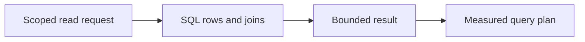
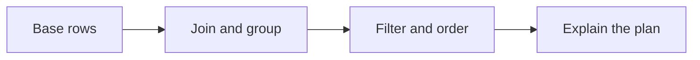
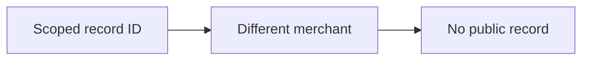
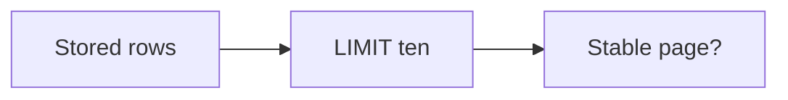

# SEQ-10 | G68: Build and explain useful SQL queries

## Goal

Deliver a small read boundary that explains stored learning operations accurately and efficiently.

## Picture First

Read left to right: Scoped read request -> SQL rows and joins -> Bounded result -> Measured query plan.

## Prerequisites

- SEQ-09: [issue #80](https://github.com/Prem-Tomar/payment-api/issues/80).

Start after G67. Use only synthetic/local learning records. A query plan is database work to inspect, not a number to guess.

## Implementation Parts

1. Implement one scoped read query with explicit columns, filters, a stable order, and a bounded page size.
2. Add a read result that joins learning records with idempotency records. Handle missing matches and NULL values deliberately.
3. Add a small grouped summary of learning operations. Explain the difference between filtering rows and filtering groups.
4. Inspect the read query with EXPLAIN on representative local data. Add an appropriate index only after comparing the plan and write cost.

## Completion Criteria

- Merchant scope applies to every query and join.
- Paging has a stable order; NULL and missing matches do not silently remove needed rows.
- Summary counts match the raw learning rows.
- The chosen index is justified by actual plans. A sequential scan on a small table is not automatically a defect.
- Show the connected success path and at least one relevant failure path in the PR discussion. A short explanation or demonstration is enough; no learner-written test suite or document is required.

## Scope

Use local learning data only. PostgreSQL stores operational/request metadata. Keep financial calculations, ledger rules, processor calls, and real payment lifecycle decisions outside this assignment.

Routine tests and documentation are reviewer-owned.

Learning discussion - not extra implementation requirements

## What, Why, And Where

- What: Deliver a small read boundary that explains stored learning operations accurately and efficiently.
- Why: the components must keep the same promise when they are connected.
- Where: follow the picture above through the existing project files.
- Earlier learning: Builds on SQL insert/select, scoped records, linked retry rows, and application read boundaries.
- Later use: G69-G74 continue with updates, paging under concurrent writes, isolation, locks, schema changes, and recovery.

Words used here: Join: combine related rows. NULL: an absent or unknown value. Aggregate: combine several rows into a summary. Index: a structure that can help find rows. Query plan: the work the database chooses to run a query.

## Software And Design Principle

Interface Segregation and Single Responsibility: give read callers a small query contract rather than a large storage API. An index is a storage choice, not a new domain rule.

Use a pattern only when it solves a visible problem. A Go function or small interface may be enough. [Short principle guide](../../software-design-principles.md).

## Database Learning Connection

Read left to right: Base rows -> Join and group -> Filter and order -> Explain the plan.

This assignment includes database implementation. See the SQL practice guide for clause order, row prediction, failure behavior, and query-plan coaching.
[In-depth SQL guide](../../sql-learning-guide.md).

## Question of the Day

Previously learned concepts: Builds on SQL insert/select, scoped records, linked retry rows, and application read boundaries.

Read left to right: Scoped record ID -> Different merchant -> No public record.

A scoped lookup finds no row for merchant A, while merchant B has the same local ID. Why must the earlier lookup contract not fall back to a global search? Explain the difference between a missing scoped record and missing merchant identity.

Use your own words. Any programming language, pseudocode, or a sketch is welcome. If the question concerns Go or SQL semantics, explain that original behavior correctly.

## Interview Problem

Read left to right: Stored rows -> LIMIT ten -> Stable page?.

A query returns ten rows without ORDER BY. Can a client rely on the same ten next time? State the promise you would need before calling it a page.

## Research Hints

Search `PostgreSQL joins NULL count`, `WHERE GROUP BY HAVING`, `stable keyset pagination`, and `PostgreSQL EXPLAIN ANALYZE`.

Look up the concept, inspect the relevant project code, then make your own implementation decision. Hints are not a complete solution.

For discussion, any programming language, pseudocode, or diagram is accepted. QOD revisits earlier work; the interview examples explore different scenarios. [How learning answers are reviewed](../../learning-and-interview-guide.md).

