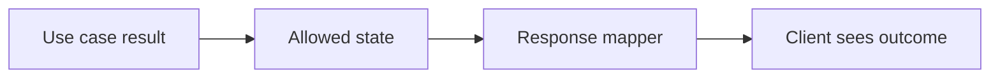
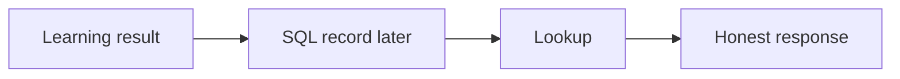
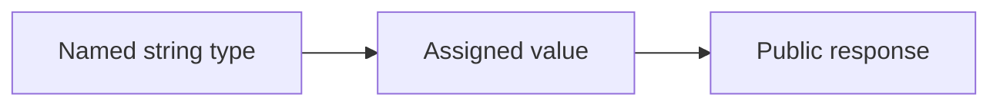
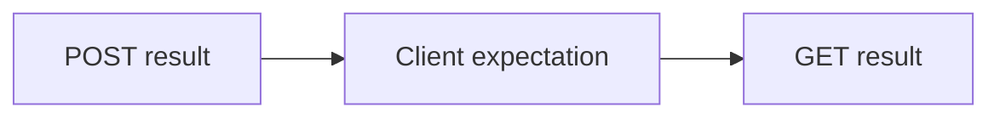

# SEQ-04 | G15/G39/G51/G52: Make application results and API output agree

## Goal

Make the public response describe what the application really did.

## Prerequisites

- SEQ-02: [issue #59](https://github.com/Prem-Tomar/payment-api/issues/59).

## Picture First

Read left to right: Use case result -> Allowed state -> Response mapper -> Client sees outcome.

## Combined Inventory

Complete the related parts below together. Source requests and saved originals are linked for reference.

- [Original #20](https://github.com/Prem-Tomar/payment-api/issues/20): Day G15: Add first payment intent route shell. [Saved original](../legacy/issue-20.md).
- [Original #46](https://github.com/Prem-Tomar/payment-api/issues/46): Day G39: Add payment intent lifecycle state model. [Saved original](../legacy/issue-46.md).
- [Original #60](https://github.com/Prem-Tomar/payment-api/issues/60): Day G51: Add application result status boundary. [Saved original](../legacy/issue-60.md).
- [Original #62](https://github.com/Prem-Tomar/payment-api/issues/62): Day G52: Add payment intent response mapper boundary. [Saved original](../legacy/issue-62.md).

## Implementation Parts

1. Keep placeholder creation explicit; do not claim a resource exists when none is created (#20).
2. Use the intended lifecycle vocabulary, including requires_confirmation (#46).
3. Let the application result own its status (#60).
4. Map that result through a small response mapper (#62).

## Completion Criteria

- Status code, body, ID, and placeholder meaning agree.
- The application result and HTTP DTO remain separate.
- No real processor, lifecycle engine, or payment behavior is added.
- Show the connected success path and at least one relevant failure path in the PR discussion. A short explanation or demonstration is enough; no learner-written test suite or document is required.

## Scope

This grouping keeps the original Go requirements. Database content below is coaching only; no SQL or database code is added to these legacy goals. Keep existing exclusions. Do not add real money movement, processor calls, or financial-domain logic.

Routine tests and documentation are reviewer-owned.

Learning discussion - not extra implementation requirements

## What, Why, And Where

- What: Make the public response describe what the application really did.
- Why: the components must keep the same promise when they are connected.
- Where: follow the picture above through the existing project files.
- Earlier learning: Builds on typed response values, fake services, the create port, and lookup.
- Later use: A later stored learning record can be read after creation. Database storage will not decide financial lifecycle rules.

Words used here: Lifecycle state: a named stage in a resource's progress. Mapper: a small function that translates one data shape into another.

## Software And Design Principle

Single Responsibility; State is a behavioral-pattern preview. A typed state alone is not a full state machine.

Use a pattern only when it solves a visible problem. A Go function or small interface may be enough. [Short principle guide](../../software-design-principles.md).

## Database Learning Connection

Read left to right: Learning result -> SQL record later -> Lookup -> Honest response.

This picture is a future preview. Explain the connection if useful, but do not implement SQL as an extra requirement of this assignment.
[In-depth SQL guide](../../sql-learning-guide.md).

## Question of the Day

Previously learned concepts: Builds on typed response values, fake services, the create port, and lookup.

Read left to right: Named string type -> Assigned value -> Public response.

A named string type is used for a resource state. Does that type alone guarantee that every value is allowed? Explain using the earlier typed-status work.

Use your own words. Any programming language, pseudocode, or a sketch is welcome. If the question concerns Go or SQL semantics, explain that original behavior correctly.

## Interview Problem

Read left to right: POST result -> Client expectation -> GET result.

POST returns created, but GET cannot find the ID. What promise did the client hear? Show a truthful placeholder outcome without adding storage.

## Research Hints

Search `HTTP 201 resource semantics`, `Go response mapper`, and `typed state versus state machine`.

Look up the concept, inspect the relevant project code, then make your own implementation decision. Hints are not a complete solution.

For discussion, any programming language, pseudocode, or diagram is accepted. QOD revisits earlier work; the interview examples explore different scenarios. [How learning answers are reviewed](../../learning-and-interview-guide.md).

