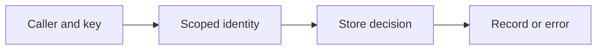
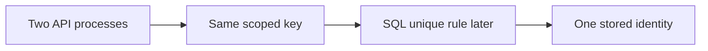
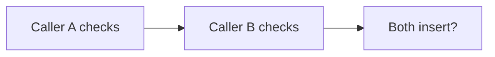
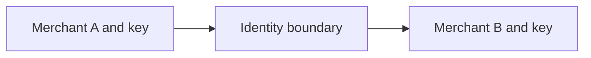

# SEQ-03 | G53/G55/G59/G60: Protect identity and merchant-scoped records

## Goal

Make record identity and caller scope safe across create and lookup boundaries.

## Prerequisites

The existing service/store foundations are enough. No unfinished assignment is required.

## Picture First

Read left to right: Caller and key -> Scoped identity -> Store decision -> Record or error.

## Combined Inventory

Complete the related parts below together. Source requests and saved originals are linked for reference.

- [Original #61](https://github.com/Prem-Tomar/payment-api/issues/61): Day G53: Add fake payment intent ID sequence boundary. [Saved original](../legacy/issue-61.md).
- [Original #65](https://github.com/Prem-Tomar/payment-api/issues/65): Day G55: Reject duplicate payment intent IDs in the memory store. [Saved original](../legacy/issue-65.md).
- [Original #72](https://github.com/Prem-Tomar/payment-api/issues/72): Day G59: Scope idempotency records by merchant. [Saved original](../legacy/issue-72.md).
- [Original #73](https://github.com/Prem-Tomar/payment-api/issues/73): Day G60: Validate merchant scope in the lookup use case. [Saved original](../legacy/issue-73.md).

## Implementation Parts

1. Put visibly fake ID generation behind a small dependency (#61).
2. Reject duplicate IDs without overwriting the old record (#65).
3. Include merchant identity in idempotency record lookup shape (#72).
4. Reject missing merchant scope before application lookup reaches the store (#73).

## Completion Criteria

- A duplicate save preserves the original record.
- A missing scope differs from a valid lookup with no result.
- Independent merchants can use the same retry key safely in the boundary shape.
- The duplicate check and insert form one protected decision.
- Show the connected success path and at least one relevant failure path in the PR discussion. A short explanation or demonstration is enough; no learner-written test suite or document is required.

## Scope

This grouping keeps the original Go requirements. Database content below is coaching only; no SQL or database code is added to these legacy goals. Keep existing exclusions. Do not add real money movement, processor calls, or financial-domain logic.

Routine tests and documentation are reviewer-owned.

Learning discussion - not extra implementation requirements

## What, Why, And Where

- What: Make record identity and caller scope safe across create and lookup boundaries.
- Why: the components must keep the same promise when they are connected.
- Where: follow the picture above through the existing project files.
- Earlier learning: Builds on scoped store keys, request retry keys, fake IDs, and mutex protection.
- Later use: A PostgreSQL unique constraint can later protect shared identity across server processes. One Go mutex protects only its own process.

Words used here: Idempotency: retrying one action without accidental duplicate work. Atomic decision: the check and change cannot be split by a competing caller.

## Software And Design Principle

GRASP Information Expert: give a decision to the component that has the needed data. Creator responsibility and a factory mechanism are separate ideas.

Use a pattern only when it solves a visible problem. A Go function or small interface may be enough. [Short principle guide](../../software-design-principles.md).

## Database Learning Connection

Read left to right: Two API processes -> Same scoped key -> SQL unique rule later -> One stored identity.

This picture is a future preview. Explain the connection if useful, but do not implement SQL as an extra requirement of this assignment.
[In-depth SQL guide](../../sql-learning-guide.md).

## Question of the Day

Previously learned concepts: Builds on scoped store keys, request retry keys, fake IDs, and mutex protection.

Read left to right: Caller A checks -> Caller B checks -> Both insert?.

Two callers check that an ID is absent before either takes the insertion lock. Can both still think creation is safe? Separate data-race safety from protecting one create decision.

Use your own words. Any programming language, pseudocode, or a sketch is welcome. If the question concerns Go or SQL semantics, explain that original behavior correctly.

## Interview Problem

Read left to right: Merchant A and key -> Identity boundary -> Merchant B and key.

Two merchants use the same retry key. Draw the values that identify their requests. Which values belong to caller scope?

## Research Hints

Search `Go map check insert mutex`, `tenant scoped idempotency`, and `Go ID generator dependency`.

Look up the concept, inspect the relevant project code, then make your own implementation decision. Hints are not a complete solution.

For discussion, any programming language, pseudocode, or diagram is accepted. QOD revisits earlier work; the interview examples explore different scenarios. [How learning answers are reviewed](../../learning-and-interview-guide.md).

