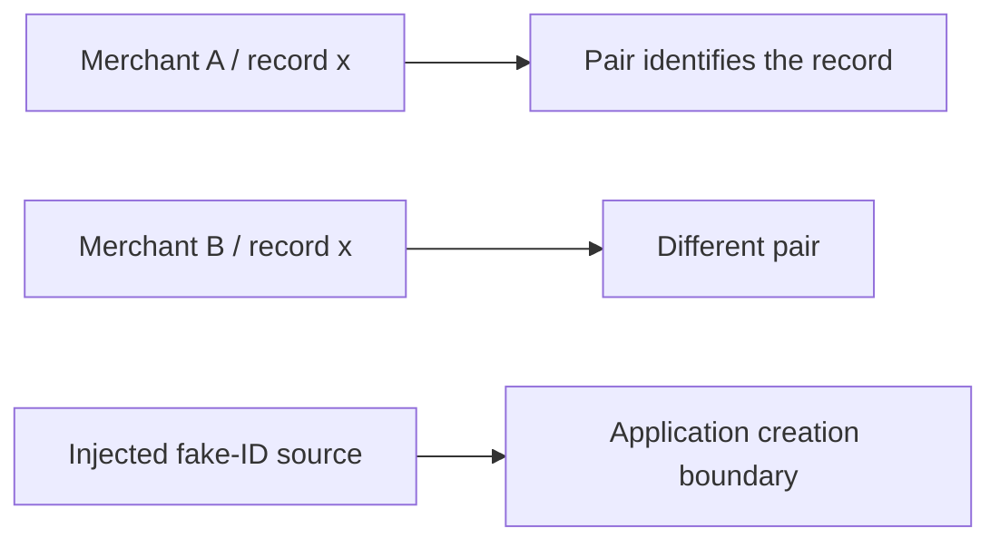
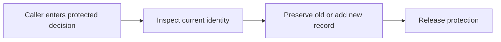
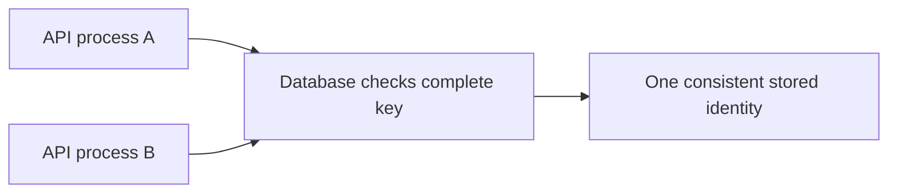
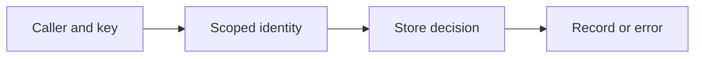
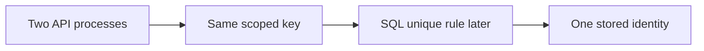
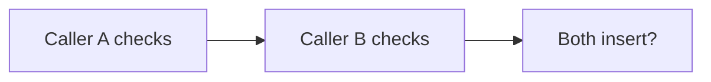
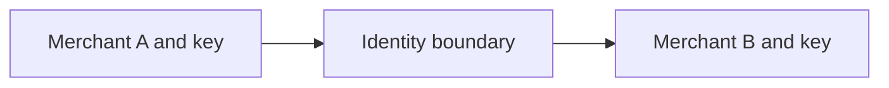

# SEQ-03 | G53/G55/G59/G60: Protect identity and merchant-scoped records

## Goal

Make record identity and caller scope safe across create and lookup boundaries.

## Learn Before Building

### 1. Identity has a boundary

Scope is the boundary within which a value has meaning. A merchant-scoped identity includes merchant identity and local record identity together. A retry key is a caller-supplied label for a logical request. Idempotency means repeating that same request should not cause an accidental second effect. A fake ID generator is a replaceable source of visibly synthetic IDs for learning behavior.

**Worked example:** Two offices can both issue ticket 12. The office name is part of the ticket's identity. Likewise, a local record or retry key must be interpreted together with its owner. Missing owner information is an invalid boundary; a known owner with no matching record is a different outcome.

**Common mistake:** Searching globally after a scoped miss can expose another merchant's record. A fake ID must not be described as a real processor payment identifier.

**Why and where:** This extends scoped lookup and prepares for later database keys. The current work remains Go boundary behavior.

### 2. Protect a decision, not only a map access

Concurrency means operations overlap in time. A mutex lets only one participating caller enter a protected section at a time. Atomic here means the whole decision is protected as one unit: inspect identity, decide whether creation is allowed, and preserve or add the record. This is broader than making each map read and write individually safe.

**Worked example:** A seat reservation checks availability and marks the seat taken while holding the same protection. Locking only the final assignment leaves a gap between the decision and the change. In this task, the duplicate rule belongs to the record store rather than being guessed in each handler.

**Common mistake:** Two individually protected operations do not automatically form one protected business decision. A process-local mutex also cannot coordinate every separate API process.

**Why and where:** GRASP is a set of responsibility guidelines. Its Information Expert guideline assigns a decision to the component holding the relevant information. Creator asks who has enough information to construct a dependency; a factory is merely one construction technique, such as a Go constructor function.

### 3. Database preview: shared identity rules

A unique constraint is a database rule rejecting duplicate values for a chosen key. It can protect shared stored identity across API processes. A composite key combines several fields. A SQL adapter translates a store contract into database operations.

**Worked example:** A future catalogue table might use (shop_id, sku) as a unique identity. A duplicate insert is an outcome the application must interpret, not permission to overwrite the first row.

**Common mistake:** Assuming an adapter is interchangeable merely because its Go methods compile can miss different duplicate behavior.

**Why and where:** This connects the current store promise to G65/G66. It is coaching context here, not an added SQL implementation requirement.

## Prerequisites

The existing service/store foundations are enough. No unfinished assignment is required.

## Picture First

Read left to right: Caller and key -> Scoped identity -> Store decision -> Record or error.

## Combined Inventory

Complete the related parts below together. Source requests and saved originals are linked for reference.

- [Original #61](https://github.com/Prem-Tomar/payment-api/issues/61): Day G53: Add fake payment intent ID sequence boundary. [Saved original](../legacy/issue-61.md).
- [Original #65](https://github.com/Prem-Tomar/payment-api/issues/65): Day G55: Reject duplicate payment intent IDs in the memory store. [Saved original](../legacy/issue-65.md).
- [Original #72](https://github.com/Prem-Tomar/payment-api/issues/72): Day G59: Scope idempotency records by merchant. [Saved original](../legacy/issue-72.md).
- [Original #73](https://github.com/Prem-Tomar/payment-api/issues/73): Day G60: Validate merchant scope in the lookup use case. [Saved original](../legacy/issue-73.md).

## Implementation Parts

1. Put visibly fake ID generation behind a small dependency (#61).
2. Reject duplicate IDs without overwriting the old record (#65).
3. Include merchant identity in idempotency record lookup shape (#72).
4. Reject missing merchant scope before application lookup reaches the store (#73).

## Completion Criteria

- A duplicate save reports a recognizable application conflict error and preserves the original record.
- The fake implementation no longer owns a literal ID inline. Replacing its visibly fake ID dependency is straightforward.
- A missing scope differs from a valid lookup with no result.
- The idempotency record and lookup interface explicitly include merchant, operation, and retry key. Independent merchants can use the same key in the boundary shape; this does not add a durable replay engine.
- Missing or whitespace-only merchant identity stops application lookup before the store. Return a recognizable application error and map it at HTTP; keep operational endpoints independent of merchant scope.
- The duplicate check and insert form one protected decision.
- Show the connected success path and at least one relevant failure path in the PR discussion. A short explanation or demonstration is enough; no learner-written test suite or document is required.

## Scope

This grouping keeps the original Go requirements. Database content in this assignment is coaching only; no SQL or database code is added to these legacy goals. Keep existing exclusions. Do not add real money movement, processor calls, or financial-domain logic.

Routine tests and documentation are reviewer-owned.

Learning discussion - not extra implementation requirements

## What, Why, And Where

- What: Make record identity and caller scope safe across create and lookup boundaries.
- Why: the components must keep the same promise when they are connected.
- Where: follow the picture above through the existing project files.
- Earlier learning: Builds on scoped store keys, request retry keys, fake IDs, and mutex protection.
- Later use: A PostgreSQL unique constraint can later protect shared identity across server processes. One Go mutex protects only its own process.

## Software And Design Principle

GRASP Information Expert: give a decision to the component that has the needed data. Creator responsibility and a factory mechanism are separate ideas.

Use a pattern only when it solves a visible problem. A Go function or small interface may be enough. [Short principle guide](../../software-design-principles.md).

## Database Learning Connection

Read left to right: Two API processes -> Same scoped key -> SQL unique rule later -> One stored identity.

This picture is a future preview. Explain the connection if useful, but do not implement SQL as an extra requirement of this assignment.
[In-depth SQL guide](../../sql-learning-guide.md).

## Question of the Day

Previously learned concepts: Builds on scoped store keys, request retry keys, fake IDs, and mutex protection.

Read left to right: Caller A checks -> Caller B checks -> Both insert?.

Two callers check that an ID is absent before either takes the insertion lock. Can both still think creation is safe? Separate data-race safety from protecting one create decision.

Use your own words. Any programming language, pseudocode, or a sketch is welcome. If the question concerns Go or SQL semantics, explain that original behavior correctly.

## Interview Problem

Read left to right: Merchant A and key -> Identity boundary -> Merchant B and key.

Two merchants use the same retry key. Draw the values that identify their requests. Which values belong to caller scope?

## Research Hints

Search `Go map check insert mutex`, `tenant scoped idempotency`, and `Go ID generator dependency`.

Look up the concept, inspect the relevant project code, then make your own implementation decision. Hints are not a complete solution.

Reply in your own words in the PR discussion. Any programming language, pseudocode, or diagram is welcome. [Answer guidance](../../learning-and-interview-guide.md).

