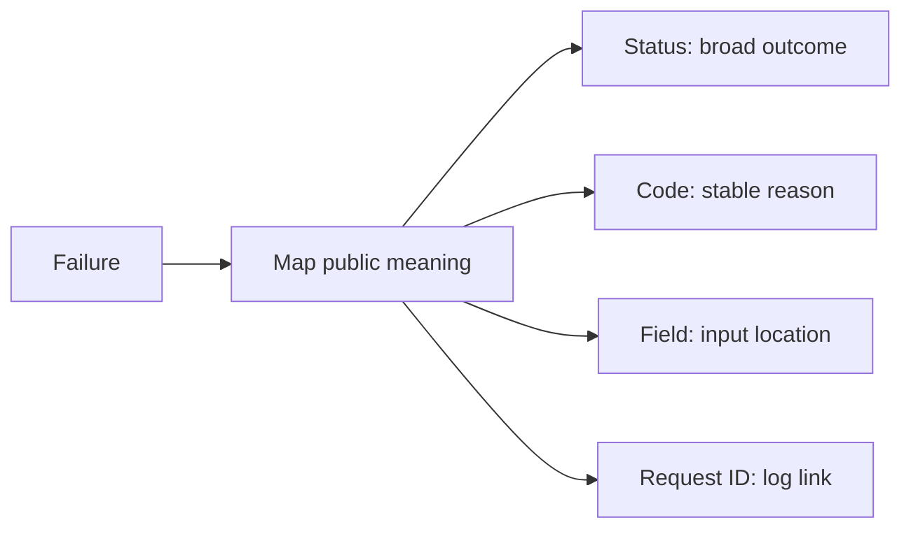
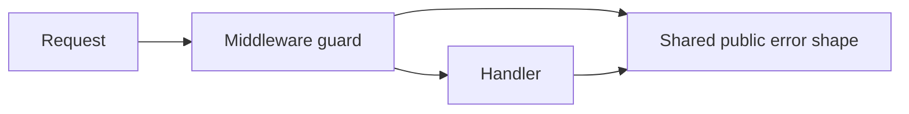
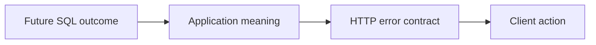
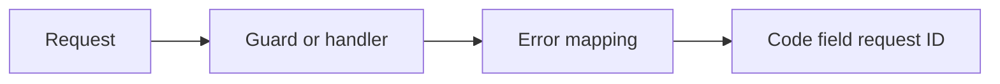
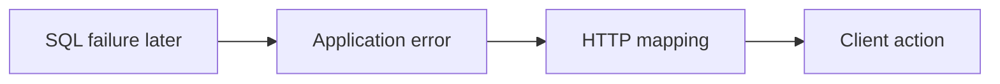
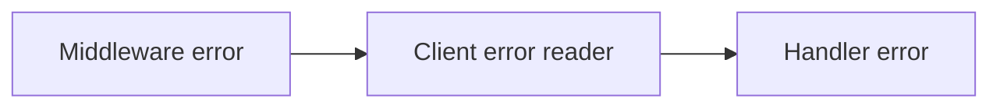
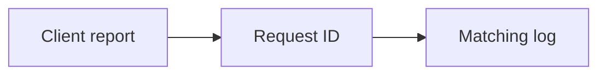

# SEQ-08 | G57/G58/G61/G63: Deliver consistent public errors

## Goal

Give clients one clear error shape across middleware and handlers.

## Learn Before Building

### 1. Each public error component has a job

An API contract is the promise a client can depend on. An error shape is its set of fields and their meanings. HTTP status describes the broad request outcome. An application error code gives a stable machine-readable reason. A field identifies the public input that needs correction. A request ID links one request to its logs; correlation means making that link.

**Worked example:** A catalogue client gets an invalid_quantity code and field quantity. It can highlight quantity without interpreting English prose. Its request ID lets support find the matching event. Public field names belong to the JSON contract, which may differ from internal Go names.

**Common mistake:** Leaking an API key, database command, or credential into a message. A request ID is a lookup aid, not proof that someone is authorized to see logs.

**Why and where:** This builds on existing shared JSON helpers and request IDs. A schema describes a message's fields, types, and requiredness; a consistent error schema makes clients simpler.

### 2. Middleware and handlers share a public boundary

Middleware runs around route handling, often to check credentials (login or API access secrets) or attach metadata. A handler receives the routed request. A path identifier is part of the URL, such as the final segment identifying a resource. A named length bound is one agreed limit used wherever that identifier is accepted. UTF-8 is the text encoding Go strings use; a byte count and a character count can differ, so choose and name the intended rule.

**Worked example:** A long item ID might arrive on both lookup and update routes. If both refer to the same identity, applying different length rules creates a surprising contract. A validation error should identify the external field rather than expose a Go struct name.

**Common mistake:** Making middleware import a handler package that already imports middleware creates an import cycle: packages depend on one another in a loop, which Go rejects.

**Why and where:** Single Responsibility separates failure detection from formatting. Interface Segregation keeps shared code small so callers do not depend on unrelated operations. Put common public shapes at a boundary both callers can use.

### 3. Database preview: translate failures at boundaries

A database adapter fits SQL behavior to the application contract. Error mapping converts tool-specific outcomes into application meaning, then into the public error shape. No row means the scoped lookup found no record; it is different from a connection failure.

**Worked example:** A missing catalogue row can become the application's not-found outcome. A database login failure must not be returned as though the item simply does not exist.

**Common mistake:** Letting raw driver messages escape because every failure is called an error.

**Why and where:** This prepares for G66 without adding SQL code to the current Go task.

## Prerequisites

- SEQ-02: [issue #59](https://github.com/Prem-Tomar/payment-api/issues/59).

## Picture First

Read left to right: Request -> Guard or handler -> Error mapping -> Code field request ID.

## Combined Inventory

Complete the related parts below together. Source requests and saved originals are linked for reference.

- [Original #70](https://github.com/Prem-Tomar/payment-api/issues/70): Day G57: Add consistent middleware error codes. [Saved original](../legacy/issue-70.md).
- [Original #71](https://github.com/Prem-Tomar/payment-api/issues/71): Day G58: Bound payment intent path identifier length. [Saved original](../legacy/issue-71.md).
- [Original #74](https://github.com/Prem-Tomar/payment-api/issues/74): Day G61: Identify the invalid field in API validation responses. [Saved original](../legacy/issue-74.md).
- [Original #76](https://github.com/Prem-Tomar/payment-api/issues/76): Day G63: Correlate API error responses with request IDs. [Saved original](../legacy/issue-76.md).

## Implementation Parts

1. Add intentional error codes to API-key and merchant-scope failures (#70).
2. Apply one named path-ID length rule to lookup and confirmation (#71).
3. Identify the public field for field-validation errors (#74).
4. Reuse the established request ID in error responses (#76).

## Completion Criteria

- Status, code, field, and request ID agree with the failure.
- Internal secrets and Go field names do not leak.
- Valid requests, success responses, and operational routes keep their behavior.
- Missing API key, missing merchant scope, and malformed merchant scope each have an intentional code while preserving existing HTTP statuses.
- Trim path IDs before applying the shared empty/maximum-length rule on lookup and confirmation. State whether length counts bytes or characters; ID spelling does not prove ownership or existence.
- The field identifier is optional and uses the public JSON name. Malformed JSON and unexpected errors do not invent a field.
- Reuse the middleware request ID when available. Define a small fallback when it is absent; do not generate a competing ID in the error helper.
- Show the connected success path and at least one relevant failure path in the PR discussion. A short explanation or demonstration is enough; no learner-written test suite or document is required.

## Scope

This grouping keeps the original Go requirements. Database content in this assignment is coaching only; no SQL or database code is added to these legacy goals. Keep existing exclusions. Do not add real money movement, processor calls, or financial-domain logic.

Routine tests and documentation are reviewer-owned.

Learning discussion - not extra implementation requirements

## What, Why, And Where

- What: Give clients one clear error shape across middleware and handlers.
- Why: the components must keep the same promise when they are connected.
- Where: follow the picture above through the existing project files.
- Earlier learning: Builds on shared JSON helpers, validation codes, request IDs, and middleware.
- Later use: A future SQL adapter should map database failures into application errors before public formatting.

## Software And Design Principle

Single Responsibility and Interface Segregation: share the error shape without making every caller depend on unrelated HTTP details.

Use a pattern only when it solves a visible problem. A Go function or small interface may be enough. [Short principle guide](../../software-design-principles.md).

## Database Learning Connection

Read left to right: SQL failure later -> Application error -> HTTP mapping -> Client action.

This picture is a future preview. Explain the connection if useful, but do not implement SQL as an extra requirement of this assignment.
[In-depth SQL guide](../../sql-learning-guide.md).

## Question of the Day

Previously learned concepts: Builds on shared JSON helpers, validation codes, request IDs, and middleware.

Read left to right: Middleware error -> Client error reader -> Handler error.

A middleware failure has only a message. A handler failure has a code. What extra work does this give a client? Which earlier helper can give both paths one contract?

Use your own words. Any programming language, pseudocode, or a sketch is welcome. If the question concerns Go or SQL semantics, explain that original behavior correctly.

## Interview Problem

Read left to right: Client report -> Request ID -> Matching log.

A client reports an error message used by many requests. Show how one request ID helps you find the right log without exposing secrets.

## Research Hints

Search `Go shared error response import cycle`, `Gin validator JSON field name`, and `request correlation ID`.

Look up the concept, inspect the relevant project code, then make your own implementation decision. Hints are not a complete solution.

Reply in your own words in the PR discussion. Any programming language, pseudocode, or diagram is welcome. [Answer guidance](../../learning-and-interview-guide.md).

