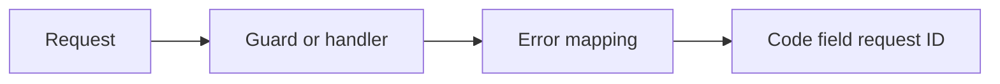
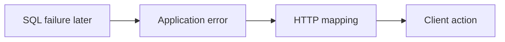
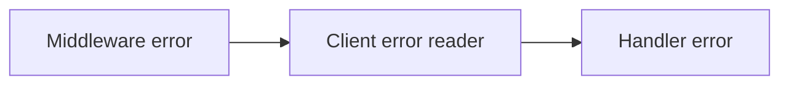
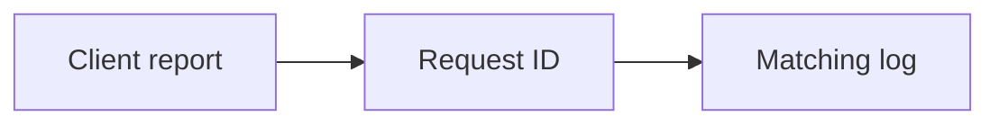

# SEQ-08 | G57/G58/G61/G63: Deliver consistent public errors

## Goal

Give clients one clear error shape across middleware and handlers.

## Prerequisites

- SEQ-02: [issue #59](https://github.com/Prem-Tomar/payment-api/issues/59).

## Picture First

Read left to right: Request -> Guard or handler -> Error mapping -> Code field request ID.

## Combined Inventory

Complete the related parts below together. Source requests and saved originals are linked for reference.

- [Original #70](https://github.com/Prem-Tomar/payment-api/issues/70): Day G57: Add consistent middleware error codes. [Saved original](../legacy/issue-70.md).
- [Original #71](https://github.com/Prem-Tomar/payment-api/issues/71): Day G58: Bound payment intent path identifier length. [Saved original](../legacy/issue-71.md).
- [Original #74](https://github.com/Prem-Tomar/payment-api/issues/74): Day G61: Identify the invalid field in API validation responses. [Saved original](../legacy/issue-74.md).
- [Original #76](https://github.com/Prem-Tomar/payment-api/issues/76): Day G63: Correlate API error responses with request IDs. [Saved original](../legacy/issue-76.md).

## Implementation Parts

1. Add intentional error codes to API-key and merchant-scope failures (#70).
2. Apply one named path-ID length rule to lookup and confirmation (#71).
3. Identify the public field for field-validation errors (#74).
4. Reuse the established request ID in error responses (#76).

## Completion Criteria

- Status, code, field, and request ID agree with the failure.
- Internal secrets and Go field names do not leak.
- Valid requests and operational routes keep their behavior.
- Show the connected success path and at least one relevant failure path in the PR discussion. A short explanation or demonstration is enough; no learner-written test suite or document is required.

## Scope

This grouping keeps the original Go requirements. Database content below is coaching only; no SQL or database code is added to these legacy goals. Keep existing exclusions. Do not add real money movement, processor calls, or financial-domain logic.

Routine tests and documentation are reviewer-owned.

Learning discussion - not extra implementation requirements

## What, Why, And Where

- What: Give clients one clear error shape across middleware and handlers.
- Why: the components must keep the same promise when they are connected.
- Where: follow the picture above through the existing project files.
- Earlier learning: Builds on shared JSON helpers, validation codes, request IDs, and middleware.
- Later use: A future SQL adapter should map database failures into application errors before public formatting.

Words used here: API contract: a promise clients rely on. Correlation ID: a value that links one response to its logs.

## Software And Design Principle

Single Responsibility and Interface Segregation: share the error shape without making every caller depend on unrelated HTTP details.

Use a pattern only when it solves a visible problem. A Go function or small interface may be enough. [Short principle guide](../../software-design-principles.md).

## Database Learning Connection

Read left to right: SQL failure later -> Application error -> HTTP mapping -> Client action.

This picture is a future preview. Explain the connection if useful, but do not implement SQL as an extra requirement of this assignment.
[In-depth SQL guide](../../sql-learning-guide.md).

## Question of the Day

Previously learned concepts: Builds on shared JSON helpers, validation codes, request IDs, and middleware.

Read left to right: Middleware error -> Client error reader -> Handler error.

A middleware failure has only a message. A handler failure has a code. What extra work does this give a client? Which earlier helper can give both paths one contract?

Use your own words. Any programming language, pseudocode, or a sketch is welcome. If the question concerns Go or SQL semantics, explain that original behavior correctly.

## Interview Problem

Read left to right: Client report -> Request ID -> Matching log.

A client reports an error message used by many requests. Show how one request ID helps you find the right log without exposing secrets.

## Research Hints

Search `Go shared error response import cycle`, `Gin validator JSON field name`, and `request correlation ID`.

Look up the concept, inspect the relevant project code, then make your own implementation decision. Hints are not a complete solution.

For discussion, any programming language, pseudocode, or diagram is accepted. QOD revisits earlier work; the interview examples explore different scenarios. [How learning answers are reviewed](../../learning-and-interview-guide.md).

