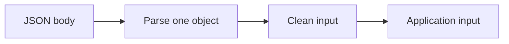
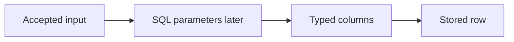
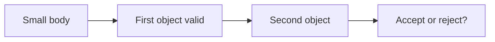
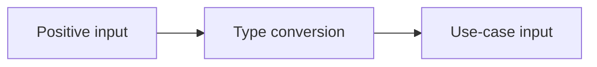

# SEQ-07 | G54/G56/G62: Complete the request-input path

## Goal

Make accepted HTTP input reach the application without lost fields or changed numbers.

## Prerequisites

- SEQ-02: [issue #59](https://github.com/Prem-Tomar/payment-api/issues/59).

## Picture First

Read left to right: JSON body -> Parse one object -> Clean input -> Application input.

## Combined Inventory

Complete the related parts below together. Source requests and saved originals are linked for reference.

- [Original #64](https://github.com/Prem-Tomar/payment-api/issues/64): Day G54: Reject trailing JSON in create payment intent requests. [Saved original](../legacy/issue-64.md).
- [Original #66](https://github.com/Prem-Tomar/payment-api/issues/66): Day G56: Preserve currency and payment method in application input. [Saved original](../legacy/issue-66.md).
- [Original #75](https://github.com/Prem-Tomar/payment-api/issues/75): Day G62: Preserve amount width across the application boundary. [Saved original](../legacy/issue-75.md).

## Implementation Parts

1. Reject a second JSON value or trailing junk; allow trailing spaces (#64).
2. Pass currency and payment method with the accepted request fields (#66).
3. Keep the amount width unchanged between the DTO and application input (#75).

## Completion Criteria

- Bad input stops before the use case.
- Accepted amount, currency, method, and references reach the use case unchanged except intentional cleanup.
- Existing body-size and error-code rules still apply.
- Show the connected success path and at least one relevant failure path in the PR discussion. A short explanation or demonstration is enough; no learner-written test suite or document is required.

## Scope

This grouping keeps the original Go requirements. Database content below is coaching only; no SQL or database code is added to these legacy goals. Keep existing exclusions. Do not add real money movement, processor calls, or financial-domain logic.

Routine tests and documentation are reviewer-owned.

Learning discussion - not extra implementation requirements

## What, Why, And Where

- What: Make accepted HTTP input reach the application without lost fields or changed numbers.
- Why: the components must keep the same promise when they are connected.
- Where: follow the picture above through the existing project files.
- Earlier learning: Builds on JSON binding, body limits, reference cleanup, and the application interface.
- Later use: Later SQL columns must receive the same accepted values. SQL parameters keep values separate from query text.

Words used here: DTO: the struct used to read or write HTTP data. Normalization: changing accepted input to one agreed form.

## Software And Design Principle

Single Responsibility Principle: parsing, cleanup, and use-case work have different reasons to change.

Use a pattern only when it solves a visible problem. A Go function or small interface may be enough. [Short principle guide](../../software-design-principles.md).

## Database Learning Connection

Read left to right: Accepted input -> SQL parameters later -> Typed columns -> Stored row.

This picture is a future preview. Explain the connection if useful, but do not implement SQL as an extra requirement of this assignment.
[In-depth SQL guide](../../sql-learning-guide.md).

## Question of the Day

Previously learned concepts: Builds on JSON binding, body limits, reference cleanup, and the application interface.

Read left to right: Small body -> First object valid -> Second object -> Accept or reject?.

A body is under the size limit. It has one valid object and then a second object. Does the size check prove the whole body is valid? Explain the separate jobs of size checking and parsing.

Use your own words. Any programming language, pseudocode, or a sketch is welcome. If the question concerns Go or SQL semantics, explain that original behavior correctly.

## Interview Problem

Read left to right: Positive input -> Type conversion -> Use-case input.

A handler accepts a positive int64 amount, then converts it to a smaller integer type. Point to the place where information can change. What must the application input promise?

## Research Hints

Search `Go json Decoder trailing data`, `Go int int64 conversion`, and `DTO application input mapping`.

Look up the concept, inspect the relevant project code, then make your own implementation decision. Hints are not a complete solution.

For discussion, any programming language, pseudocode, or diagram is accepted. QOD revisits earlier work; the interview examples explore different scenarios. [How learning answers are reviewed](../../learning-and-interview-guide.md).

