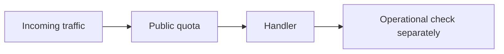
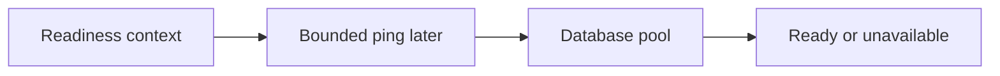
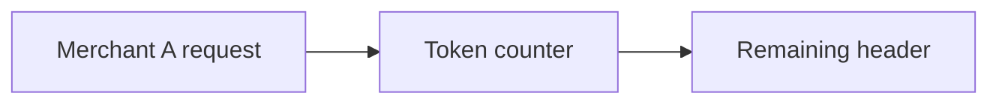
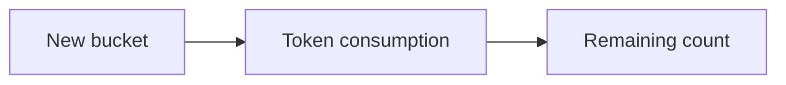
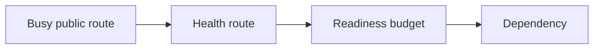
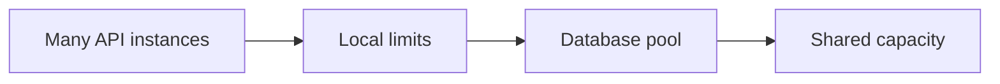

# G43/G64: Make runtime guards predictable under load

## Goal

Keep public rate limits and readiness work within clear request budgets.

## Picture First

Read left to right: Incoming traffic -> Public quota -> Handler -> Operational check separately.

## Combined Inventory

This is one delivery assignment, not several separate PR tasks. Original goals are grouped below. A closed source issue means superseded, not achieved. Complete and review each listed goal before claiming it is done.

- [Original #51](https://github.com/Prem-Tomar/payment-api/issues/51): Day G43: Add rate limit response header boundary. [Saved original](../legacy/issue-51.md).
- [Original #77](https://github.com/Prem-Tomar/payment-api/issues/77): Day G64: Pass request context into readiness checks. [Saved original](../legacy/issue-77.md).

## Implementation Parts

1. Charge each allowed request once and report honest limit headers (#51).
2. Pass the request context into the readiness checker (#77).

## Completion Criteria

- A fresh five-token bucket has four left after one request.
- Rejected clients get a clear retry delay.
- Merchants have separate counters and operational routes stay outside the public limiter.
- Readiness receives the caller's context and stays cheap by default.
- Show the connected success path and at least one relevant failure path in the PR discussion. A short explanation or demonstration is enough; no learner-written test suite or document is required.

## What, Why, And Where

- What: Keep public rate limits and readiness work within clear request budgets.
- Why: the components must keep the same promise when they are connected.
- Where: follow the picture above through the existing project files.
- Earlier learning: Builds on merchant extraction, the token bucket, operational routes, and injectable readiness.
- Later use: A later database readiness check should use a short bounded ping. Pool limits and request quotas control different resources.

Words used here: Token: permission for one request. Readiness: whether the service can accept work. Budget: a limit on time or resources.

## Software And Design Principle

Strategy is a behavioral-pattern preview for replaceable limit policy. Resource ownership means knowing who starts, shares, and closes work.

Use a pattern only when it solves a visible problem. A Go function or small interface may be enough. [Short principle guide](../../software-design-principles.md).

## Database Learning Connection

Read left to right: Readiness context -> Bounded ping later -> Database pool -> Ready or unavailable.

This picture is a future preview. Explain the connection if useful, but do not implement SQL as an extra requirement of this assignment.
[In-depth SQL guide](../../sql-learning-guide.md).

## Question of the Day

Previously learned concepts: Builds on merchant extraction, the token bucket, operational routes, and injectable readiness.

Read left to right: Merchant A request -> Token counter -> Remaining header.

Each merchant begins with five tokens. After one request from merchant A, what should A and B each have left? Why must checking and consuming one token happen together?

Explain in your own words. Use short sentences, bullets, or a small sketch. We assess the reasoning, not English grammar.

## Interview Practice

**Active level: Small.** Start here. The mentor activates a harder level only after the learner can explain the simple case and an edge case, use a familiar example without step-by-step help, and says they are comfortable. Task number and time spent do not automatically raise the interview level.

### Small - active

Read left to right: New bucket -> Token consumption -> Remaining count.

The first response says limit five, remaining three. Trace the new-bucket and common paths. What does one allowed request promise?

Moderate - later practice, not active yet

Read left to right: Busy public route -> Health route -> Readiness budget -> Dependency.

Traffic is rejected by the public limiter. Explain why a health check should still run and how you would keep readiness from waiting forever.

New concepts in this preview must be explained before this level is assigned.

Strong - future practice, not active yet

Read left to right: Many API instances -> Local limits -> Database pool -> Shared capacity.

Later, several server instances share one database. Compare a per-process quota, a connection-pool limit, and one shared quota. Which overload does each control?

The mentor introduces any new concepts first. This is a preview, not a requirement to implement another system now.

## Research Hints

Search `token bucket initial capacity`, `Go readiness context`, and `rate limit versus connection pool`.

Look up the concept, inspect the relevant project code, then make your own implementation decision. Hints are not a complete solution.

## Scope And Coaching Agreement

This grouping keeps the original Go requirements. Database content below is coaching only; no SQL or database code is added to these legacy goals. Keep existing exclusions. Do not add real money movement, processor calls, or financial-domain logic.

Reviewers own routine tests and documentation. Implementation review checks the listed behavior. Questions and interview answers belong in the related PR description or comment, in the learner's own words. Preserve original answers and add focused corrections. Missing, partial, or incorrect learning answers are non-blocking for an otherwise correct implementation. No extra code, tests, or documentation are needed to answer.

