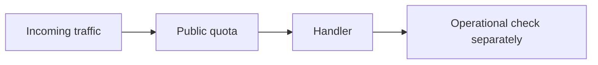
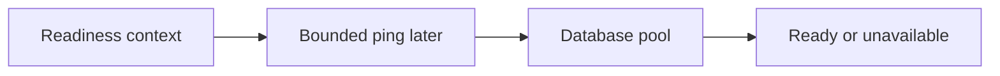
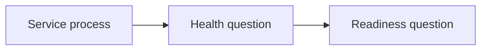
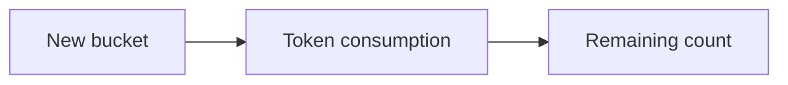

# SEQ-05 | G43/G64: Make runtime guards predictable under load

## Goal

Keep public rate limits and readiness work within clear request budgets.

## Prerequisites

The existing service/store foundations are enough. No unfinished assignment is required.

## Picture First

Read left to right: Incoming traffic -> Public quota -> Handler -> Operational check separately.

## Combined Inventory

Complete the related parts below together. Source requests and saved originals are linked for reference.

- [Original #51](https://github.com/Prem-Tomar/payment-api/issues/51): Day G43: Add rate limit response header boundary. [Saved original](../legacy/issue-51.md).
- [Original #77](https://github.com/Prem-Tomar/payment-api/issues/77): Day G64: Pass request context into readiness checks. [Saved original](../legacy/issue-77.md).

## Implementation Parts

1. Charge each allowed request once and report honest limit headers (#51).
2. Pass the request context into the readiness checker (#77).

## Completion Criteria

- A fresh five-token bucket has four left after one request.
- Rejected clients get a clear retry delay.
- Merchants have separate counters and operational routes stay outside the public limiter.
- Readiness receives the caller's context and stays cheap by default.
- Show the connected success path and at least one relevant failure path in the PR discussion. A short explanation or demonstration is enough; no learner-written test suite or document is required.

## Scope

This grouping keeps the original Go requirements. Database content below is coaching only; no SQL or database code is added to these legacy goals. Keep existing exclusions. Do not add real money movement, processor calls, or financial-domain logic.

Routine tests and documentation are reviewer-owned.

Learning discussion - not extra implementation requirements

## What, Why, And Where

- What: Keep public rate limits and readiness work within clear request budgets.
- Why: the components must keep the same promise when they are connected.
- Where: follow the picture above through the existing project files.
- Earlier learning: Builds on merchant extraction, the token bucket, operational routes, and injectable readiness.
- Later use: A later database readiness check should use a short bounded ping. Pool limits and request quotas control different resources.

Words used here: Token: permission for one request. Readiness: whether the service can accept work. Budget: a limit on time or resources.

## Software And Design Principle

Strategy is a behavioral-pattern preview for replaceable limit policy. Resource ownership means knowing who starts, shares, and closes work.

Use a pattern only when it solves a visible problem. A Go function or small interface may be enough. [Short principle guide](../../software-design-principles.md).

## Database Learning Connection

Read left to right: Readiness context -> Bounded ping later -> Database pool -> Ready or unavailable.

This picture is a future preview. Explain the connection if useful, but do not implement SQL as an extra requirement of this assignment.
[In-depth SQL guide](../../sql-learning-guide.md).

## Question of the Day

Previously learned concepts: Builds on merchant extraction, the token bucket, operational routes, and injectable readiness.

Read left to right: Service process -> Health question -> Readiness question.

The health endpoint can return OK while readiness returns unavailable. Can both answers be correct? Explain the different questions these earlier endpoints answer.

Use your own words. Any programming language, pseudocode, or a sketch is welcome. If the question concerns Go or SQL semantics, explain that original behavior correctly.

## Interview Problem

Read left to right: New bucket -> Token consumption -> Remaining count.

The first response says limit five, remaining three. Trace the new-bucket and common paths. What does one allowed request promise?

## Research Hints

Search `token bucket initial capacity`, `Go readiness context`, and `rate limit versus connection pool`.

Look up the concept, inspect the relevant project code, then make your own implementation decision. Hints are not a complete solution.

For discussion, any programming language, pseudocode, or diagram is accepted. QOD revisits earlier work; the interview examples explore different scenarios. [How learning answers are reviewed](../../learning-and-interview-guide.md).

