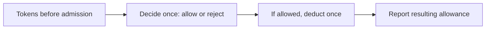
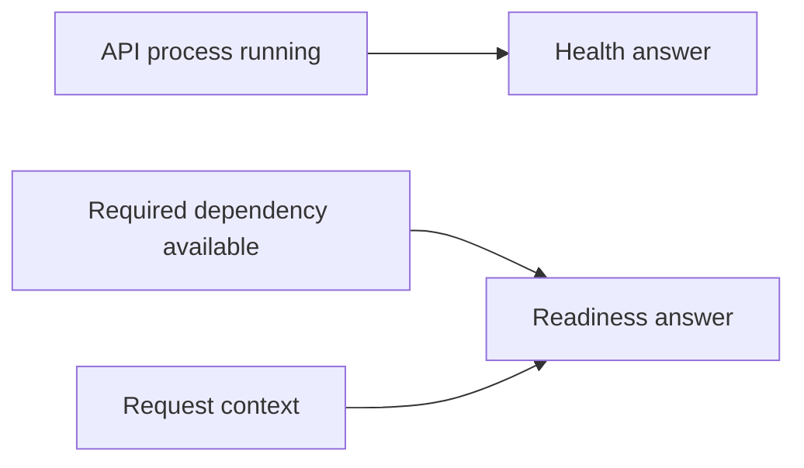
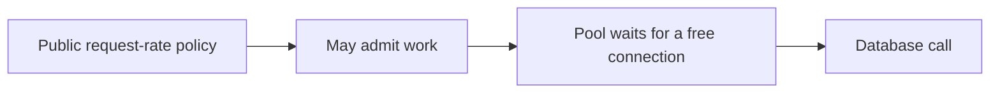
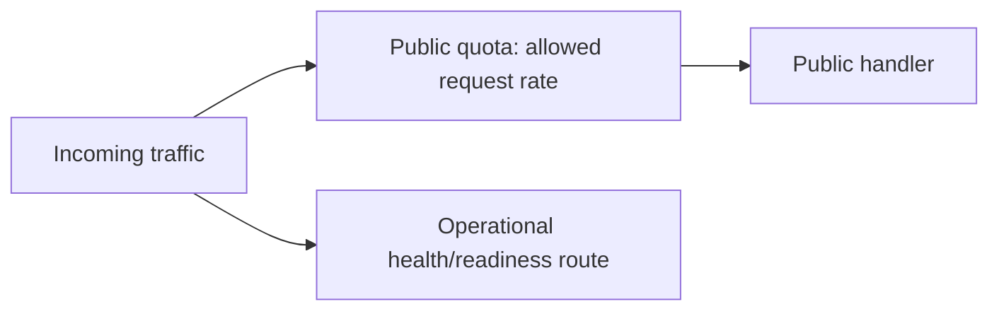
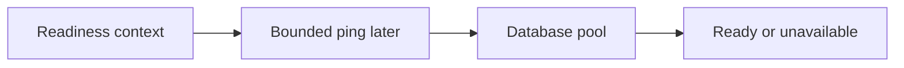
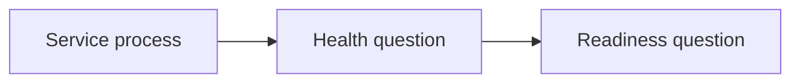
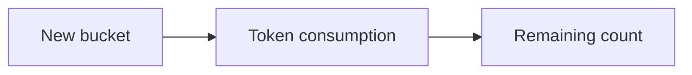

# SEQ-05 | G43/G64: Make runtime guards predictable under load

## Goal

Keep public rate limits and readiness work within clear request budgets.

## Learn Before Building

### 1. Rate limits count permission to start

A rate limiter bounds how often callers can start work. A token bucket is one model: the bucket has a capacity, each admitted request consumes a token, and tokens refill over time. A response header is named information sent beside the body. Limit and remaining headers must describe the same admission decision.

**Worked trace:** An illustrative bucket has 8 tokens. One allowed request leaves 7. Refilling later restores tokens up to capacity. A rejected request needs a retry delay, meaning when the caller should try again under the agreed policy. Separate merchant buckets prevent one merchant consuming another's allowance.

**Common mistake:** Running a special new-bucket deduction and a common-path deduction counts one request twice. Reading headers from a second mutation can also misreport the decision.

**Why and where:** This extends public API middleware. A Strategy is a behavioral pattern for replaceable policies behind a common contract; a small function or interface is enough when a real variation exists.

### 2. Health and readiness ask different questions

Health asks whether the API process is functioning. Readiness asks whether it can currently accept its intended traffic. A checker is the dependency used to answer a readiness question. A request context carries a stop signal and deadline; a bounded check stops waiting when that budget ends.

**Worked example:** The process can answer its health route while a required dependency is unavailable. Its readiness result can therefore differ. Operational routes are endpoints used to inspect or manage the service; placing them inside the public merchant limiter can make monitoring misleading.

**Common mistake:** Creating a fresh background context for readiness loses the caller's budget. A checker that performs expensive work on every health request can worsen an outage.

**Why and where:** This builds on existing health/readiness separation and context passing. Keep checks cheap and route ownership explicit.

### 3. Database preview: capacity is not request rate

A connection is a communication session with PostgreSQL. A pool is a reusable group of these sessions, managed in Go by sql.DB. A ping checks whether a database connection can communicate; it does not prove every application query will succeed. Resource ownership identifies who creates, shares, and closes the handle.

**Worked example:** A limiter may admit 20 requests over time while only 2 database sessions are available at once. Some admitted work may wait. A request deadline must cover that wait too.

**Common mistake:** Treating rate limits and connection capacity as interchangeable, or doing an unbounded database check in a readiness path.

**Why and where:** G66 uses this connection to add a bounded SQL readiness check. This legacy Go assignment only passes the context; it does not add database code.

## Prerequisites

The existing service/store foundations are enough. No unfinished assignment is required.

## Picture First

Public traffic passes through its quota. Operational health/readiness routes take a separate path.

## Combined Inventory

Complete the related parts below together. Source requests and saved originals are linked for reference.

- [Original #51](https://github.com/Prem-Tomar/payment-api/issues/51): Day G43: Add rate limit response header boundary. [Saved original](../legacy/issue-51.md).
- [Original #77](https://github.com/Prem-Tomar/payment-api/issues/77): Day G64: Pass request context into readiness checks. [Saved original](../legacy/issue-77.md).

## Implementation Parts

1. Charge each allowed request once and report honest limit headers (#51).
2. Pass the request context into the readiness checker (#77).

## Completion Criteria

- A fresh five-token bucket has four left after one request.
- Rejected clients get a clear retry delay.
- Merchants have separate counters and operational routes stay outside the public limiter.
- Readiness receives the caller's context and stays cheap by default. Default success/unavailable responses remain predictable without adding a real dependency.
- Header names are consistent for allowed and rejected requests and describe the existing in-memory limiter; no distributed quota system is added.
- Show the connected success path and at least one relevant failure path in the PR discussion. A short explanation or demonstration is enough; no learner-written test suite or document is required.

## Scope

This grouping keeps the original Go requirements. Database content in this assignment is coaching only; no SQL or database code is added to these legacy goals. Keep existing exclusions. Do not add real money movement, processor calls, or financial-domain logic.

Routine tests and documentation are reviewer-owned.

Learning discussion - not extra implementation requirements

## What, Why, And Where

- What: Keep public rate limits and readiness work within clear request budgets.
- Why: the components must keep the same promise when they are connected.
- Where: follow the picture above through the existing project files.
- Earlier learning: Builds on merchant extraction, the token bucket, operational routes, and injectable readiness.
- Later use: A later database readiness check should use a short bounded ping. Pool limits and request quotas control different resources.

## Software And Design Principle

Strategy is a behavioral-pattern preview for replaceable limit policy. Resource ownership means knowing who starts, shares, and closes work.

Use a pattern only when it solves a visible problem. A Go function or small interface may be enough. [Short principle guide](../../software-design-principles.md).

## Database Learning Connection

Read left to right: Readiness context -> Bounded ping later -> Database pool -> Ready or unavailable.

This picture is a future preview. Explain the connection if useful, but do not implement SQL as an extra requirement of this assignment.
[In-depth SQL guide](../../sql-learning-guide.md).

## Question of the Day

Previously learned concepts: Builds on merchant extraction, the token bucket, operational routes, and injectable readiness.

Read left to right: Service process -> Health question -> Readiness question.

The health endpoint can return OK while readiness returns unavailable. Can both answers be correct? Explain the different questions these earlier endpoints answer.

Use your own words. Any programming language, pseudocode, or a sketch is welcome. If the question concerns Go or SQL semantics, explain that original behavior correctly.

## Interview Problem

Read left to right: New bucket -> Token consumption -> Remaining count.

The first response says limit five, remaining three. Trace the new-bucket and common paths. What does one allowed request promise?

## Research Hints

Search `token bucket initial capacity`, `Go readiness context`, and `rate limit versus connection pool`.

Look up the concept, inspect the relevant project code, then make your own implementation decision. Hints are not a complete solution.

Reply in your own words in the PR discussion. Any programming language, pseudocode, or diagram is welcome. [Answer guidance](../../learning-and-interview-guide.md).

