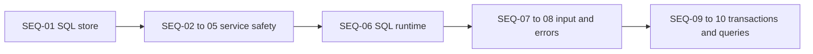

# Learning Inventory

**Pick first: [SEQ-01 / issue #78](https://github.com/Prem-Tomar/payment-api/issues/78).**

SEQ is the delivery order. G identifiers are topic references. GitHub issue numbers identify the
tracking records. Pick the lowest open SEQ whose prerequisites are complete. Do not redo work
already accepted in an earlier PR.

## Delivery Order

| Sequence | Assignment | Required earlier issues |
| --- | --- | --- |
| SEQ-01 | [#78: G65: Build a working PostgreSQL store](https://github.com/Prem-Tomar/payment-api/issues/78) | Existing foundations only |
| SEQ-02 | [#59: G44/G48/G49/G50: Carry input and request lifetime through the use case](https://github.com/Prem-Tomar/payment-api/issues/59) | Existing foundations only |
| SEQ-03 | [#65: G53/G55/G59/G60: Protect identity and merchant-scoped records](https://github.com/Prem-Tomar/payment-api/issues/65) | Existing foundations only |
| SEQ-04 | [#60: G15/G39/G51/G52: Make application results and API output agree](https://github.com/Prem-Tomar/payment-api/issues/60) | [SEQ-02 / #59](https://github.com/Prem-Tomar/payment-api/issues/59) |
| SEQ-05 | [#51: G43/G64: Make runtime guards predictable under load](https://github.com/Prem-Tomar/payment-api/issues/51) | Existing foundations only |
| SEQ-06 | [#79: G66: Integrate the SQL store with service lifecycle and errors](https://github.com/Prem-Tomar/payment-api/issues/79) | [SEQ-01 / #78](https://github.com/Prem-Tomar/payment-api/issues/78), [SEQ-02 / #59](https://github.com/Prem-Tomar/payment-api/issues/59), [SEQ-03 / #65](https://github.com/Prem-Tomar/payment-api/issues/65), [SEQ-04 / #60](https://github.com/Prem-Tomar/payment-api/issues/60), [SEQ-05 / #51](https://github.com/Prem-Tomar/payment-api/issues/51) |
| SEQ-07 | [#64: G54/G56/G62: Complete the request-input path](https://github.com/Prem-Tomar/payment-api/issues/64) | [SEQ-02 / #59](https://github.com/Prem-Tomar/payment-api/issues/59) |
| SEQ-08 | [#70: G57/G58/G61/G63: Deliver consistent public errors](https://github.com/Prem-Tomar/payment-api/issues/70) | [SEQ-02 / #59](https://github.com/Prem-Tomar/payment-api/issues/59) |
| SEQ-09 | [#80: G67: Add atomic learning records and safe retry identity in SQL](https://github.com/Prem-Tomar/payment-api/issues/80) | [SEQ-06 / #79](https://github.com/Prem-Tomar/payment-api/issues/79), [SEQ-07 / #64](https://github.com/Prem-Tomar/payment-api/issues/64), [SEQ-08 / #70](https://github.com/Prem-Tomar/payment-api/issues/70) |
| SEQ-10 | [#81: G68: Build and explain useful SQL queries](https://github.com/Prem-Tomar/payment-api/issues/81) | [SEQ-09 / #80](https://github.com/Prem-Tomar/payment-api/issues/80) |

G65 exercises the SQL adapter directly and can start now. The identity assignment aligns memory
and SQL duplicate behavior before the runtime switch. G66 also needs correct deadline handling,
honest responses, and runtime guards. G67 depends on the input/error work before write coordination.

## Preserved Source Goals

| Active assignment | Original issues | Guide |
| --- | --- | --- |
| [#64](https://github.com/Prem-Tomar/payment-api/issues/64) | #64, #66, #75 | [request-input](assignments/request-input.md) |
| [#70](https://github.com/Prem-Tomar/payment-api/issues/70) | #70, #71, #74, #76 | [public-errors](assignments/public-errors.md) |
| [#60](https://github.com/Prem-Tomar/payment-api/issues/60) | #20, #46, #60, #62 | [honest-output](assignments/honest-output.md) |
| [#59](https://github.com/Prem-Tomar/payment-api/issues/59) | #55, #56, #58, #59 | [application-lifetime](assignments/application-lifetime.md) |
| [#65](https://github.com/Prem-Tomar/payment-api/issues/65) | #61, #65, #72, #73 | [identity-safety](assignments/identity-safety.md) |
| [#51](https://github.com/Prem-Tomar/payment-api/issues/51) | #51, #77 | [runtime-guards](assignments/runtime-guards.md) |

The 21 source requests are saved in [legacy/](legacy/). Merged sources are superseded, not achieved.
Current assignments combine 2-4 related goals. Their original Go requirements are retained;
SQL content in those legacy goals is a learning connection, not a new implementation requirement.

## Database Guides

- [SEQ-01 / G65 / #78](assignments/g65-postgres-store.md).
- [SEQ-06 / G66 / #79](assignments/g66-sql-runtime.md).
- [SEQ-09 / G67 / #80](assignments/g67-atomic-retries.md).
- [SEQ-10 / G68 / #81](assignments/g68-sql-query-depth.md).

The [SQL guide](../sql-learning-guide.md) plans later depth through G74 without creating every
future issue now. Each current assignment has one interview problem and a distinct QOD.
Mentor policies live in [the coaching guide](../learning-and-interview-guide.md), not the task body.

Each active guide now teaches unfamiliar concepts before the implementation steps, using
definitions, labelled visuals, worked examples, common failures, and practical connections.
The [API contract roadmap](../api-contract-transfer-guide.md) maps these foundations to a
later complete API-design assessment without adding another problem to current tasks.

