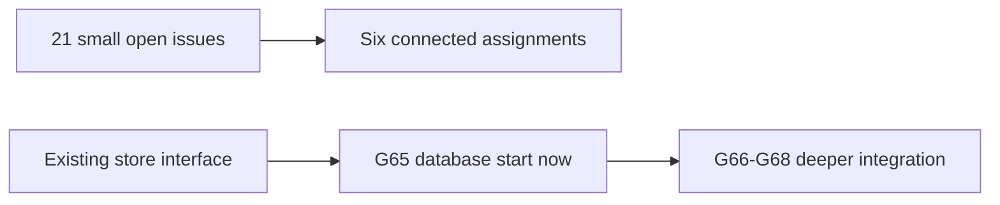

# Learning Inventory

The source requirements are preserved. Consolidation is not completion.
A merged source issue is closed as superseded. Its original text is saved in [legacy/](legacy/).
Each active assignment combines 2-4 connected goals. Deliver the combined flow, not only helpers.

## Current Go Assignments

| Main issue | Original goals | Assignment guide |
| --- | --- | --- |
| [#64](https://github.com/Prem-Tomar/payment-api/issues/64) | #64, #66, #75 | [G54/G56/G62: Complete the request-input path](assignments/request-input.md) |
| [#70](https://github.com/Prem-Tomar/payment-api/issues/70) | #70, #71, #74, #76 | [G57/G58/G61/G63: Deliver consistent public errors](assignments/public-errors.md) |
| [#60](https://github.com/Prem-Tomar/payment-api/issues/60) | #20, #46, #60, #62 | [G15/G39/G51/G52: Make application results and API output agree](assignments/honest-output.md) |
| [#59](https://github.com/Prem-Tomar/payment-api/issues/59) | #55, #56, #58, #59 | [G44/G48/G49/G50: Carry input and request lifetime through the use case](assignments/application-lifetime.md) |
| [#65](https://github.com/Prem-Tomar/payment-api/issues/65) | #61, #65, #72, #73 | [G53/G55/G59/G60: Protect identity and merchant-scoped records](assignments/identity-safety.md) |
| [#51](https://github.com/Prem-Tomar/payment-api/issues/51) | #51, #77 | [G43/G64: Make runtime guards predictable under load](assignments/runtime-guards.md) |

Database examples in these assignments are coaching previews. Their original Go implementation scope is unchanged.
Do not repeat work already accepted; identify the remaining source goals in the combined PR.

## Database Assignments

| Day | Start rule | Guide |
| --- | --- | --- |
| G65 | Ready to start now. Reuse the completed store interface and merchant-scoped lookup. You do not need to finish every queued HTTP task first. | [G65: Build a working PostgreSQL store](assignments/g65-postgres-store.md) |
| G66 | Start after G65. Fix the request-lifetime assignment's malformed deadline response before enabling real query calls in HTTP. | [G66: Integrate the SQL store with service lifecycle and errors](assignments/g66-sql-runtime.md) |
| G67 | Start after G65 and the identity-safety assignment. Use request metadata already carried into the application. G66 is needed before HTTP wiring. | [G67: Add atomic learning records and safe retry identity in SQL](assignments/g67-atomic-retries.md) |
| G68 | Start after G67. Use only synthetic/local learning records. A query plan is database work to inspect, not a number to guess. | [G68: Build and explain useful SQL queries](assignments/g68-sql-query-depth.md) |

G65 can begin now. Its first connection/schema work does not wait for every current HTTP assignment.
Finish the shared duplicate-record contract before claiming store substitutability. Fix request-lifetime
response handling before enabling live SQL calls in HTTP. The [SQL guide](../sql-learning-guide.md)
plans further depth through G74 without adding all later assignments to today's queue.

## Learning Rules

All assignments have a visual, a Question of the Day, a principle connection, and three interview
scenarios. Small is active. Moderate and Strong are previews until the learner is comfortable.
See [the coaching guide](../learning-and-interview-guide.md). Tests and routine documentation
remain reviewer-owned. Learning-answer gaps are non-blocking; implementation defects are separate.

