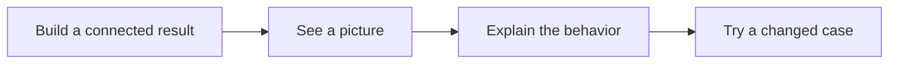
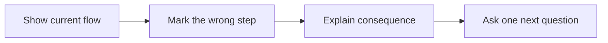
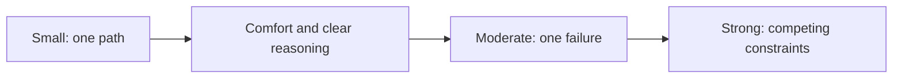
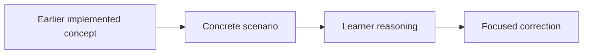
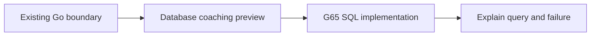

# Learning, Coaching, And Interview Practice

Read left to right. Build, explain, then apply the idea in a different situation.

## Larger Implementation Assignments

An assignment now combines 2-4 related goals. It should cross a useful project path.
For example, database setup, schema, Save, and Get form one working store.
One new type or helper usually belongs inside an assignment or a review comment.

Keep the parts related. Do not add unrelated work just to make a task longer.
Use one PR for the connected result when practical. Check each source goal before closing it.
If old issues are merged, preserve their text and links. Mark them superseded, not achieved.
The inventory map is in [curriculum/index.md](curriculum/index.md).

Routine tests and documentation remain reviewer-owned. A short demonstration of the connected
success path and a failure path can show familiarity with the code. It is not a new document task.

## Visual-First Feedback

Apply this to issue coaching, PR summaries, inline findings, QOD feedback, and follow-ups.
Use 3-6 labelled nodes or a short execution trace. Put the actual problem in the picture.
Do not attach an unrelated architecture image. Add one sentence that describes the picture.

An inline finding should identify the exact file/line, the required change, and the involved
components. Explain why the behavior matters. Connect one earlier concept and one useful later
application. Future connections are previews, not hidden implementation requirements.

Use short sentences and familiar English. Define a new term beside its first use.
Keep code names exact. Say "a group of writes that commit together" before using "transaction".
Accept short answers, bullets, code traces, or sketches. Do not grade English grammar.

## Interview Difficulty

| Level | Active expectation | Move up when |
| --- | --- | --- |
| Small | Trace one request, state one promise, explain one edge case. | The learner explains it with little help and feels ready. |
| Moderate | Compare two choices and explain a failure path. | The learner can justify a choice and handle a changed example. |
| Strong | Reason about concurrent work, partial failure, capacity, and tradeoffs. | The mentor introduces missing concepts first; the learner is comfortable. |

Start every learner at Small for new interview topics. Larger coding assignments do not force
harder interview questions. Time spent and task numbers are not proof of mastery.
Each task includes all three statements, but later levels are folded away as previews.
Only the active level is assigned. Do not ask for three complete system designs at once.

## Question Of The Day

A QOD revisits learned concepts. Do not quiz unintroduced future topics.
Use a picture and ask for a prediction, mechanism, consequence, or changed condition.
The learner answers every part in their own words in the PR discussion.
Keep the original answer. Mark it Correct, Partially correct, Needs correction, or Awaiting answer.
Explain one misunderstanding at a time. Ask a small follow-up instead of pasting a full solution.

Learning answers are expected but non-blocking. A missing answer does not block an otherwise
correct implementation. Actual code defects remain implementation findings.

## SQL And Design Principles

Before G65, database examples add context without changing current Go scope.
G65 can begin now because the store interface and scoped lookup already exist.
Read [the SQL guide](sql-learning-guide.md) and [the principle guide](software-design-principles.md).
Explain what, why, and where. Use a principle to discuss a real design choice, not to require a class hierarchy.

## Before Publishing A Task

- Confirm it has 2-4 connected parts and observable integrated behavior.
- Include a real QOD, not a placeholder.
- Include Small, Moderate, and Strong scenarios with separate pictures.
- Keep Small active until readiness is demonstrated.
- Define new words and show earlier/future connections.
- Preserve routine-test/documentation ownership and non-blocking learning feedback.
- Read the saved GitHub body back and verify these sections are actually present.
