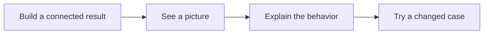
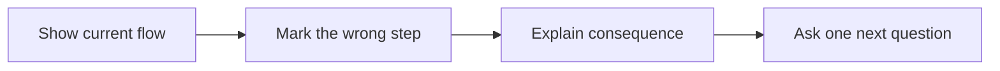
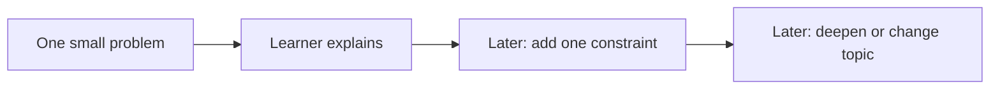
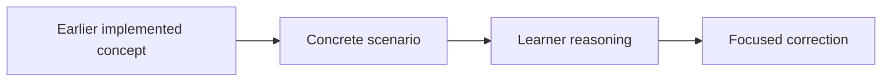
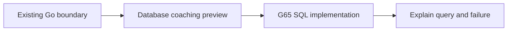

# Learning, Coaching, And Interview Practice

Teach unfamiliar concepts with pictures and examples before implementation begins.
Then build, explain, and apply the idea in a different situation.

## Larger Implementation Assignments

An assignment now combines 2-4 related goals. It should cross a useful project path.
For example, database setup, schema, Save, and Get form one working store.
One new type or helper usually belongs inside an assignment or a review comment.

Keep the parts related. Do not add unrelated work just to make a task longer.
Use one PR for the connected result when practical. Check each source goal before closing it.
If old issues are merged, preserve their text and links. Mark them superseded, not achieved.
The inventory map is in [curriculum/index.md](curriculum/index.md).

Routine tests and documentation remain reviewer-owned. A short demonstration of the connected
success path and a failure path can show familiarity with the code. It is not a new document task.

## Visual-First Feedback

Apply this to issue coaching, PR summaries, inline findings, QOD feedback, and follow-ups.
Use 3-6 labelled nodes or a short execution trace. Put the actual problem in the picture.
Do not attach an unrelated architecture image. Add one sentence that describes the picture.

An inline finding should identify the exact file/line, the required change, and the involved
components. Explain why the behavior matters. Connect one earlier concept and one useful later
application. Future connections are previews, not hidden implementation requirements.

Use short sentences and familiar English. Define a new term beside its first use.
Keep code names exact. Say "a group of writes that commit together" before using "transaction".
Accept short answers, bullets, code traces, or sketches. Do not grade English grammar.

## Mentor Guidance: Interview Progression

Publish one interview problem per task. Start the sequence with a small scenario.
In later tasks or follow-ups, add a failure, a tradeoff, or another constraint.
The next problem may extend an earlier topic or introduce a new one.
Carry demonstrated understanding forward instead of resetting familiar topics to Small.
There is no explicit comfort-declaration gate. Adjust help when an answer reveals a gap.
Do not publish three difficulty alternatives together. Keep these mentor policies out of task bodies.
Larger implementation assignments still need connected, demanding project work.

## Question Of The Day

A QOD revisits learned concepts. Do not quiz unintroduced future topics.
It must not repeat the interview problem. The interview problem applies ideas to a fresh
scenario; QOD recalls earlier work. The two can connect without asking the same thing twice.
Use a picture and ask for a prediction, mechanism, consequence, or changed condition.
The learner answers every part in their own words in the PR discussion.
Keep the original answer. Mark it Correct, Partially correct, Needs correction, or Awaiting answer.
Explain one misunderstanding at a time. Ask a small follow-up instead of pasting a full solution.

Accept learning answers in Java, Python, JavaScript, Go, another programming language,
pseudocode, or diagrams. Judge the concept, not the chosen syntax. If a question is about
Go or SQL semantics, the answer must still explain that original behavior correctly and
identify differences when using another language. Implementation languages remain as scoped.

Learning answers are expected but non-blocking. A missing answer does not block an otherwise
correct implementation. Actual code defects remain implementation findings.

## SQL And Design Principles

Before G65, database examples add context without changing current Go scope.
G65 can begin now because the store interface and scoped lookup already exist.
Read [the SQL guide](sql-learning-guide.md) and [the principle guide](software-design-principles.md).
Explain what, why, and where. Use a principle to discuss a real design choice, not to require a class hierarchy.

For transferable API-design coverage and a later complete assessment, use the
[API contract roadmap](api-contract-transfer-guide.md). It distinguishes taught foundations
from a full exercise that still needs to be assessed. Do not add future coding scope to a
current issue merely to claim coverage.

## Before Starting Each Batch

- Read the complete `AGENTS.md`, this guide, the current inventory, and relevant earlier
  learner answers once before each batch of issue creation, updates, or replacements.
  Batch size is unrestricted: 1, 10, 20, or any other number of issues needs one full rule
  check before starting, not one read per issue. Repeat the full check before the next
  batch; a single issue also counts as a batch. Apply the whole rule
  set to every issue. Incorporate any rule changes made during the batch into all affected
  issues. The same rules apply to current tasks.

## Check Every Issue Before Completing The Batch

- Audit unfamiliar concepts in diagrams, requirements, hints, QOD, and interview problems.
  Before asking the learner to use a concept, teach it in place with a labelled picture,
  a worked example or trace, a common failure, and what/why/where it is useful. A glossary
  or external reading link alone is insufficient. References may add depth. Do not provide
  the complete assigned implementation or introduce another quiz or gate.
- Confirm it has 2-4 connected parts and observable integrated behavior.
- Include a real QOD, not a placeholder.
- Include one interview problem with its own picture; do not duplicate QOD.
- Keep mentor progression rules and grading rubrics out of the task body.
- Accept any programming language or sketch for conceptual answers.
- Define new words and show earlier/future connections.
- Preserve routine-test/documentation ownership and non-blocking learning feedback.
- Read the saved GitHub body back and verify these sections are actually present.
