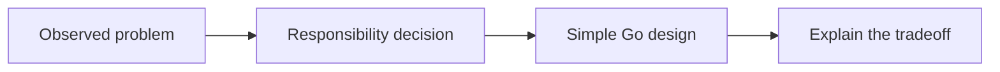
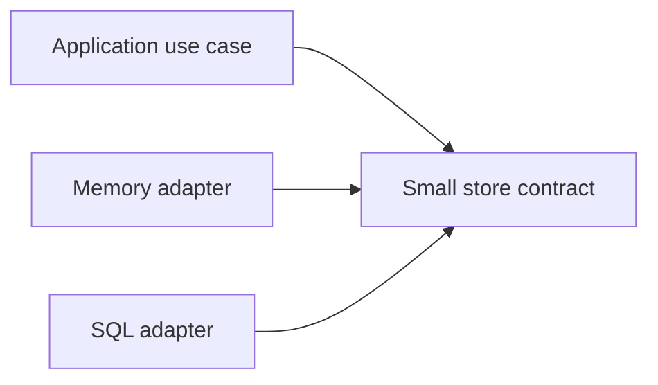
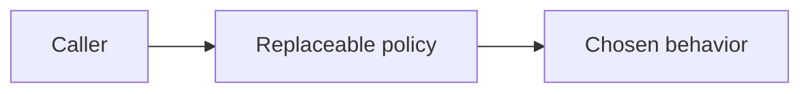
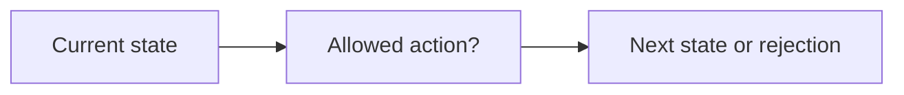
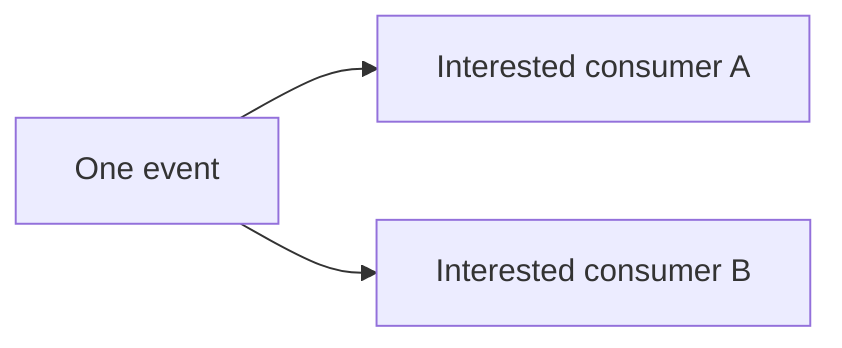

# Software And Design Principles In This Project

Start with the problem. A principle is a reasoning tool, not a demand to add more code.

## SOLID In Common English

| Principle | Meaning | Project question |
| --- | --- | --- |
| Single Responsibility | Keep different reasons to change separate. | Should a handler parse HTTP, build SQL, and own shutdown? |
| Open/Closed | Add a variation through a stable boundary when it is useful. | Can a SQL adapter be added without rewriting each handler? |
| Liskov Substitution | A replacement must keep the caller's behavioral promise. | Do memory and SQL stores agree about missing records and duplicates? |
| Interface Segregation | Let callers depend on only the operations they need. | Does a read-only service need a large write-and-admin interface? |
| Dependency Inversion | Important application behavior uses contracts rather than tool details. | Does the use case need a store interface or the PostgreSQL driver? |

The arrows show dependencies. Matching a Go interface is necessary, but behavior must match too.
An adapter translates a tool into the contract the application needs.

## Creator Responsibility And Creational Patterns

GRASP Creator is a responsibility question: which component has the information needed to
construct and connect an object? Information Expert asks which component has the data needed
to make a decision. These ideas help place responsibilities.

A creational pattern is a construction technique. Factory Method, Abstract Factory, and Builder
are examples. They do not answer every responsibility question by themselves.
In Go, a constructor function may be enough. Do not create a factory framework for one constructor.
Do not copy a class hierarchy just because a pattern example uses classes.

## Behavioral Patterns

Strategy means placing a replaceable behavior behind a small contract. A limiter policy may
eventually fit this idea. Do not introduce it before an actual variation is useful.

State separates behavior by a resource's stage. A typed status is only a vocabulary; it is not
automatically the full State pattern or a valid transition engine. Financial lifecycle rules
still belong to the domain owner, not to a SQL constraint or an HTTP handler.

Observer lets interested consumers receive a change. Discuss failure and ordering before using
it for logs or notifications. Do not add an event bus just to demonstrate the name.

A middleware chain resembles a chain of responsibility, but it is not automatically the exact
textbook pattern. An application input called a command is not automatically the GoF Command pattern.
Always explain the actual behavior in this code first.

## Questions For A Review

1. What problem does this principle help solve here?
2. Which component should own the decision and data?
3. What simpler design would also work?
4. What becomes harder if we add this abstraction now?

## Reading

- [Craig Larman: design, GRASP, and SOLID topics](https://craiglarman.com/wiki/index.php?title=Advanced_Object_Design_with_Patterns_and_Agile_Modeling).
- [The pattern authors on pattern categories and responsibilities](https://www.informit.com/articles/article.aspx?p=1327762).
- [Original design-pattern catalog](https://www.informit.com/store/design-patterns-elements-of-reusable-object-oriented-9780321770462).
