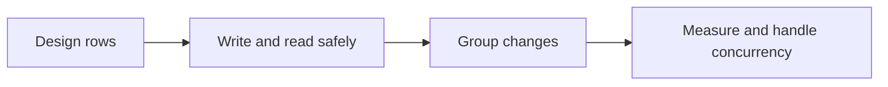
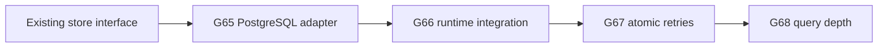
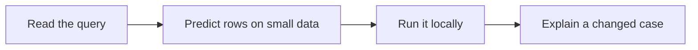
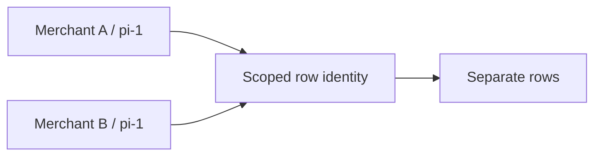
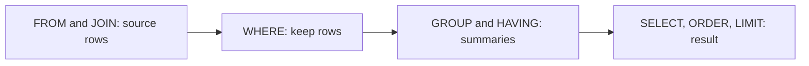
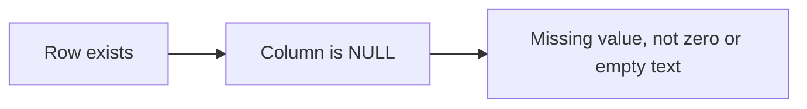
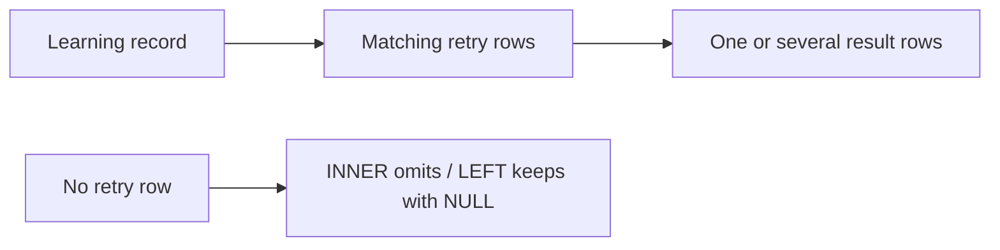
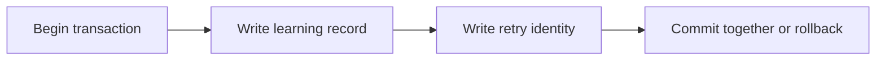
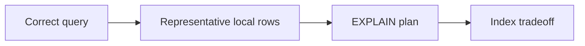
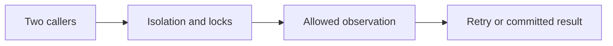

# In-Depth SQL Learning

This is implementation learning, not only a Go-driver tutorial.
PostgreSQL stores local operational/request metadata. It does not take ownership of exact money
arithmetic, ledger truth, or financial lifecycle decisions.

## Start Now At G65

G65 needs the existing store contract and merchant-scoped lookup. It does not wait for unrelated
queued HTTP tasks. G66 must wait for correct cancellation/error handling before real SQL calls
are enabled in HTTP. Use a local PostgreSQL instance; a local container is one option, not a new
deployment project. Choose a supported stable release when implementing, not a prerelease by default.

Use `database/sql` with the pgx standard-library adapter for this track. A `sql.DB` manages a
reusable connection pool; it is not one connection per request. See the official
[connection guide](https://go.dev/doc/database/manage-connections) and
[pgx adapter documentation](https://pkg.go.dev/github.com/jackc/pgx/v5/stdlib).

## The SQL Coaching Loop

For each SQL assignment, discuss these points in short PR replies:

1. What rows and columns should this query produce?
2. Which values come from the caller, and how are they passed as parameters?
3. What happens for no match, duplicate data, NULL, or another merchant?
4. Which database rule protects the data if two callers run together?
5. What work does the query plan show on representative data?

The reviewer owns routine fixtures, automated tests, and documentation. The learner writes the
scoped SQL/Go implementation and demonstrates its behavior. A query that only works against a
mock is not enough evidence for the SQL adapter's behavior. No real payment data is needed.

## Rows, Keys, Types, And Constraints

| Term | Common meaning | Reason to learn it |
| --- | --- | --- |
| Table and row | A named set of records and one record. | Decide what the service stores. |
| Primary key | The columns that identify a row. | Avoid confusing records with the same local ID. |
| NOT NULL | The database requires a value. | An identity column must not silently be absent. |
| UNIQUE | Duplicate key values are rejected under the rule. | Protect identity even across API processes. |
| Foreign key | A stored reference must point to an allowed row. | Keep related technical records consistent. |
| CHECK | A row must satisfy a simple condition. | Protect storage-level shape, not financial-domain truth. |
| Migration | A saved change to the schema. | Rebuild and evolve the local database deliberately. |

Pick types intentionally. A Go `int64` and a SQL integer column must have compatible range.
Required identity columns and uniqueness belong together. Discuss how NULL affects a unique
rule rather than assuming every missing value is an ordinary duplicate.
Read [PostgreSQL constraints](https://www.postgresql.org/docs/current/ddl-constraints.html).

## Query Meaning Before Query Speed

This is a useful logical reading order, not a promise about the physical execution plan.
Learn `INSERT`, `SELECT`, `UPDATE`, and `DELETE` with explicit scope and safe predicates.
Use `RETURNING` when the statement's own result is needed. Check the affected-row meaning.
Never turn caller values into SQL syntax by string concatenation.

### NULL And Counts

NULL means absent or unknown data. `IS NULL` is not the same question as equality with a value.
`COUNT(*)` counts rows; `COUNT(column)` counts non-NULL values in that column.
Predict results with a few rows before using aggregates in an application response.

### Joins And Missing Matches

Learn INNER JOIN and LEFT JOIN with records that have zero, one, and several matches.
Include merchant scope in related-row matching. Check where a right-side filter is placed:
moving a filter between `ON` and `WHERE` can change which missing-match rows survive.
Read the [join tutorial](https://www.postgresql.org/docs/current/tutorial-join.html) and
[table-expression guide](https://www.postgresql.org/docs/current/queries-table-expressions.html).

## Transactions And Failure

A transaction groups related database work. Keep all intended work on the transaction handle,
not partly on `sql.DB`. Treat a failed commit as a failed confirmation of the transaction's result.
An interrupted connection can leave the caller unsure of the outcome; do not blindly retry
every error. Learn scoped retry identity before repeating a write.
Read [Go transactions](https://go.dev/doc/database/execute-transactions).

## Indexes And Query Plans

An index can help find rows but also adds storage and write work. It is not a free speed switch.
Use `EXPLAIN` to inspect the chosen plan. `EXPLAIN ANALYZE` executes the query: use safe local
read queries for early practice. Small tables may reasonably use a sequential scan.
Compare estimated and actual rows before declaring a performance problem.
Read [indexes](https://www.postgresql.org/docs/current/indexes.html) and
[using EXPLAIN](https://www.postgresql.org/docs/current/using-explain.html).

## Concurrency And Later SQL Depth

Isolation describes what one transaction can observe while others run. A mutex in one Go process
does not protect every database caller. Learn PostgreSQL's actual isolation rules instead of
assuming a transaction automatically prevents every race. Read
[transaction isolation](https://www.postgresql.org/docs/current/transaction-iso.html).

The following are planned larger assignments, not extra requirements of the four current DB issues:

| Planned day | Integrated SQL work | Existing concepts it extends |
| --- | --- | --- |
| G69 | Safe UPDATE/RETURNING, NULL/defaults, affected rows, optimistic version checks. | Types, scoped predicates, error mapping. |
| G70 | Joins, GROUP BY/HAVING, window summaries, stable paging under inserts. | G68 query correctness and ordering. |
| G71 | Isolation experiments, competing transactions, consistent outcomes, bounded retries. | G67 transactions and idempotency. |
| G72 | Row locks, lock ordering, deadlock outcomes, context-aware retry limits. | Mutex reasoning and request deadlines. |
| G73 | Backward-compatible schema changes, separate migration/runtime roles, safe secrets. | Configuration, migrations, least responsibility. |
| G74 | Local backup/restore, reconnect behavior, query-plan regression analysis, capacity limits. | Persistence, operational readiness, measured performance. |

Publish one small interview problem initially and deepen the next problem gradually.
Carry prior understanding forward. Learning answers may use any programming language or a
sketch, but SQL-specific behavior must still be explained correctly. Keep mentoring rules out
of learner task bodies and keep learning follow-ups non-blocking.
