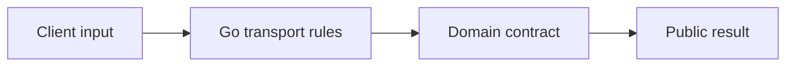
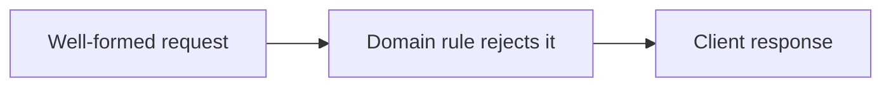
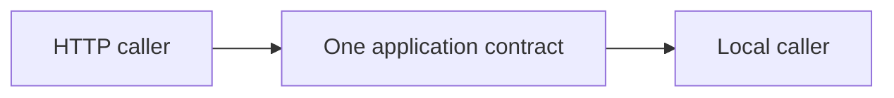

# Day G1: Payment API Boundary Contract

## Goal

Define what the Go `payment-api` service is responsible for before any service code is written.

## Real Problem

Payment APIs sit at the edge of the system. They receive external traffic, enforce transport
rules, protect the service from malformed input, and translate domain outcomes into HTTP responses.
They must be high-volume and operationally reliable, but they must not silently reimplement the
financial truth already owned by Rust libraries.

## Learning Target

- Go service boundaries.
- REST responsibility versus domain responsibility.
- Request validation categories.
- Error mapping from domain errors to HTTP responses.
- Keeping architecture documentation useful enough for another developer.

## Task

Write the first API boundary contract before code.

The document should answer:

- What kinds of requests will `payment-api` eventually receive?
- Which validation belongs in Go?
- Which validation belongs in Rust?
- Which errors should become client errors?
- Which errors should become server or dependency errors?
- What should be explicitly out of scope for the first implementation day?

## Expected Outcome

By the end of this task, another developer should understand:

- why this service exists.
- what Go is allowed to decide locally.
- what Go must delegate to Rust/domain libraries.
- what the first safe implementation task should be.
- why payment creation should not be implemented before the service boundary is agreed.

## Out Of Scope

Do not implement:

- Go module or HTTP server.
- endpoints.
- middleware.
- database access.
- authentication.
- idempotency storage.
- payment processor clients.
- ledger behavior.
- Rust integration.
- OpenAPI generation.
- Docker or deployment files.

## Validation

- The boundary document is clear enough for another developer to start from it.
- The document keeps Go service orchestration separate from Rust financial truth.
- The next task is small, concrete, and implementation-ready.
- No executable service code is added in Day G1.

## Suggested Day G2

Create a minimal Go service skeleton with health and readiness endpoints only.

Day G2 should still avoid payment creation. Its job is to establish layout, basic routing,
configuration loading shape, graceful shutdown, and validation tooling.

## Current Coaching Companion

This is a historical scope document. Do not reopen it as a new documentation assignment.
Current learning is implementation-led; routine documentation and tests are reviewer-owned.

Go accepts and translates requests. Domain code owns financial truth. Later SQL storage keeps
operational metadata; it does not make the database the financial-rule owner.
Single Responsibility means keeping these different reasons to change separate.

### Question Of The Day

Why can a request be valid JSON but still be rejected by the domain? Name the component that
should decide each case. Answer in short sentences or a sketch; English grammar is not scored.

### Interview Problem

How could both callers reuse one use case without requiring the local caller to know Gin?

Follow [the learning guide](../learning-and-interview-guide.md) for visual-first feedback and
[the inventory](../curriculum/index.md) for active implementation assignments.
