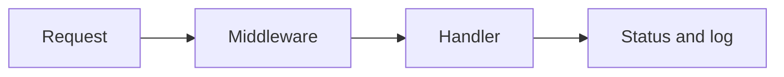
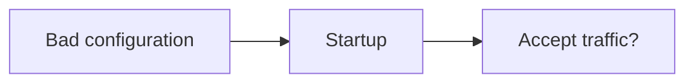
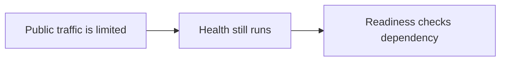
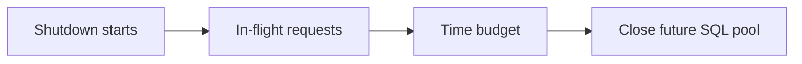

# Days G2-G9: Gin Service Foundation

## Goal

Build a small Gin-based HTTP service foundation before adding payment behavior.

Gin is the Go web framework used here. An HTTP service foundation means the basic server,
routes, middleware, responses, request limits, and runtime configuration that later payment
endpoints will rely on.

## Scope Covered

- G2: replace the initial mux server with a Gin server and graceful shutdown.
- G3: keep HTTP code in small internal packages.
- G4: add request ID middleware.
- G5: add structured access logging.
- G6: centralize JSON response helpers.
- G7: return clear method-not-allowed responses.
- G8: add a request body size guard.
- G9: load server host, port, and timeout configuration from environment variables.

## Concepts

### Gin Router

The Gin router is the object that matches an incoming HTTP request to a handler function. For
this stage it owns `/healthz` and `/readyz`.

### Middleware

Middleware is code that runs around handlers. It is useful for cross-cutting behavior, meaning
behavior shared by many routes. Request IDs, logging, panic recovery, and body-size limits are
middleware concerns in this service.

### Request ID

A request ID is a value used to connect logs and responses for the same HTTP request. If the
client sends `X-Request-ID`, the service reuses it. If the client does not send one, the service
generates one and echoes it back in the response header.

### Structured Access Logs

An access log records one HTTP request. Structured means the log uses named fields such as
method, path, status, duration, and request ID instead of only a free-form sentence.

### JSON Response Helpers

JSON response helpers are small functions that write the HTTP status code and response body in
one consistent shape. Success responses use `{"status":"..."}`. Error responses use
`{"error":"..."}`.

### Method Handling

Method handling means responding correctly when a route exists but the HTTP method is not allowed.
For example, `GET /healthz` is allowed, while `POST /healthz` should return `405 Method Not
Allowed`.

### Body Size Guard

A body size guard protects the service from reading request bodies that are too large. The request
body is the data after the request headers, such as JSON. `Content-Length` is the header where a
client declares the body size up front. `MaxBytesReader` protects reads when the body is consumed.

### Environment Configuration

Environment configuration means reading process settings such as `PORT=8080` and turning them
into typed Go values. Typed values are safer than raw strings because the server can reject
invalid values before accepting traffic.

## Current Environment Variables

| Variable | Default | Meaning |
| --- | --- | --- |
| `HOST` | `localhost` | Address host used to build the server listen address. |
| `PORT` | `8080` | TCP port used to build the server listen address. |
| `READ_TIMEOUT` | `5s` | Maximum time to read a request. |
| `WRITE_TIMEOUT` | `20s` | Maximum time to write a response. |
| `IDLE_TIMEOUT` | `30s` | Maximum time to keep an idle connection open. |
| `HEADER_TIMEOUT` | `5s` | Maximum time to read request headers. |

Invalid ports and invalid timeout values should fail before the server starts.

## Current Coaching Companion

This foundation remains the earlier implementation scope. Database content here is a preview,
not an extra requirement. Read [the current learning guide](../learning-and-interview-guide.md).

Middleware does work shared by routes. A handler owns its route's response. Construction code
creates shared dependencies. This connects Single Responsibility and Creator responsibility to
the server code already learned. Creator asks who has the information to create a dependency.

### Question Of The Day And Small Practice

Why should an invalid timeout or port fail during startup? How does that protect later requests?
Use the existing configuration and lifecycle code in your explanation.

Moderate preview - not active

Why do public traffic, health, and readiness need different boundaries?

Strong preview - not active

Later, the server owns a shared SQL pool. Explain resource ownership during shutdown after
the learner is comfortable with the earlier request and server lifetime concepts.

Small is active; later levels depend on comfort, not a day number. The actual database track
starts at G65 in [the inventory](../curriculum/index.md). No database code is added to G2-G9.
